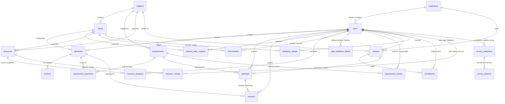

# LearningPal Data Model: Learning, Multi-Institution & Diagnostic Architecture

This document details the data architecture supporting LearningPal: multi-institution tenancy, classroom sections, curriculum structure, assessments, scheduling, retake policies, diagnostic topic-level gap analysis, personalized study resources, teacher grade overrides, and academic interventions.

---

## 1. Entity-Relationship (ER) Diagram



---

## 2. Table Dictionary

Think of the LearningPal database like a multi-school educational network:

| Table | Plain Analogy / What It Stores |
|---|---|
| `institutions` | **The School Campus:** Independent schools, colleges, or districts (e.g., *"Pilot University"*, code `PILOT-2026`). Every user and class belongs to one institution. |
| `classes` | **The Classroom Period / Section:** A specific cohort of students (e.g., *"Section A"*) studying a subject under an assigned instructor, discovered via a 6-character join code. |
| `enrollments` | **The Class Roster:** Connects a student to a specific classroom section (`student_id`, `class_id`). |
| `users` | **The School Directory:** The roster of all students, teachers, institution admins, and platform super-admins. |
| `subjects` | **The Shared Course Binder:** Platform-wide academic subjects (e.g. *"Introduction to Programming: C Language Basics"*), curated centrally and shared read-only. |
| `topics` | **The Binder Tab Dividers:** Specific learning units within a subject (e.g. *Variables*, *Loops*, *Functions*); every question and resource belongs to a topic. |
| `questions` | **The Question Bank:** Reusable test questions linked to a topic, with full explanations of correct answers and common mistakes. |
| `choices` | **The Multiple-Choice Options:** The 4 lettered options (A, B, C, D) for each question, flagging exactly one correct answer. |
| `assessments` | **The Test Papers:** Topic quizzes and comprehensive diagnostics assigned to students, with timing and scheduling windows. |
| `assessment_questions` | **The Exam Layout Sheet:** Join table connecting questions to assessments with their sequence order. |
| `assessment_access` | **The Special Permission Hall Pass:** Controls per-student test permissions: enforces the 1-attempt rule by default, allows teachers to reopen closed tests or grant retakes. |
| `attempts` | **The Student's Exam Booklet:** A student's test session, recording `attempt_number`, timestamps, scores, and the `class_id` context. |
| `answers` | **The Marked Answers:** Each response given by a student to a question, holding auto score, teacher override, and feedback. |
| `student_topic_mastery` | **The Diagnostic Report Card:** Section-specific diagnostic mastery for each topic (`STRENGTH`, `DEVELOPING`, `GAP`, or `INSUFFICIENT_DATA`), strictly scoped to `(student_id, class_id, topic_id)`. Each new class begins with a clean slate. |
| `resources` | **The Study Kit:** Flashcard-style bite-sized study notes and practice challenges designed to close learning gaps. |
| `resource_progress` | **The Reading Checklist:** Checkmarks recording whether a student has finished reviewing a recommended note or practice problem, strictly scoped to `(student_id, class_id, resource_id)`. |
| `interventions` | **The Teacher Action Plan:** Action items logged by teachers when they notice a student struggling on a topic. |
| `gap_validation_labels` | **The Validation Lab Ground Truth:** Teacher blind evaluations (`WEAK`, `NOT_WEAK`, `CANNOT_JUDGE`) or synthetic simulation parameters, with server-side snapshot of system mastery, status, and attempt count for agreement measurement. |

---

## 3. Multi-Tenant Isolation Rule

> [!IMPORTANT]
> **Strict Tenant Boundary:** Every student, teacher, and school administrator belongs to exactly one institution.
> 1. No user can view, approve, reject, deactivate, or modify data from another institution.
> 2. Direct ID guessing in URL parameters (e.g., `GET /api/admin/users/99` or `POST /api/admin/teachers/88/approve`) across institutions **always returns HTTP 404 Not Found** (via `TenantAccess`), completely preventing tenant existence discovery.
> 3. Join codes are scoped per institution: entering a code from Institution B while signed into Institution A returns HTTP 404.

---

## 4. Development Database Clean-Rebuild Option

In development environments with MySQL, if you ever need to perform a completely fresh wipe-and-rebuild of the multi-institution schema and seed data:

```bash
# 1. Drop and recreate the local database
mysql -u root -p -e "DROP DATABASE IF EXISTS learningpal; CREATE DATABASE learningpal CHARACTER SET utf8mb4 COLLATE utf8mb4_unicode_ci;"

# 2. Start the backend application (Hibernate ddl-auto=update will recreate all tables)
mvn spring-boot:run -f backend/pom.xml
```

On first startup:
- `DatabaseMigrationRunner` automatically provisions *"Pilot University"* (`PILOT-2026`).
- `AdminUserSeeder` seeds the default institution administrator (`admin@example.com` or `admin@learningpal.edu`).
- `LearningDataSeeder` seeds the full 6-topic C language pilot curriculum and default *"Section A"*.
- `SuperAdminSeeder` seeds the platform super admin (if `app.superadmin.email` is configured).

---

## 5. Test Taking, Scheduling, and Reopening Rules

### One-Time Attempt Rule
By default, students can only attempt an assessment **once**.
- When an assessment is started $\rightarrow$ `Attempt` #1 is generated (`attempt_number = 1`, `status = IN_PROGRESS`, stamped with `class_id`).
- When submitted $\rightarrow$ `status = SUBMITTED`.
- Any subsequent attempt is blocked unless a teacher explicitly grants permission via `AssessmentAccess`.

---

## 6. Classroom Loop & Join Flow Architecture

### Class Creation and Join Code Distribution
1. **Teacher Creates Section:**
   - Active teachers create a section for a subject (`POST /api/teacher/classes`).
   - The system generates an unambiguous 6-character uppercase alphanumeric join code (excluding confusing characters like `0`, `O`, `1`, `I`) that is guaranteed unique within that institution.
2. **Student Joins via Code:**
   - Students join using the 6-character code (`POST /api/student/classes/join`).
   - The lookup is **strictly scoped** to the authenticated student's institution. Codes from other institutions return HTTP 400 (never leaking tenant existence).
   - Rate limiting protects the join endpoint: exceeding 5 failed join attempts within 60 seconds returns HTTP 429 Too Many Requests with retry-after header.
3. **One Active Class per Subject Rule:**
   - A student may belong to at most **one ACTIVE class** for a given subject at any time.
   - Attempting to join a second active class for the same subject returns HTTP 409 Conflict.
   - Joining a class the student is already actively in is idempotent (returns HTTP 200 with the existing enrollment).
   - An archived class does not block a student from joining a new active class for that subject.
4. **Archiving & Attempt Integrity:**
   - Classes with student attempts are never hard-deleted; teachers archive them (`PUT/POST /api/teacher/classes/{id}/archive`).
   - Once a class is archived, new student joins are rejected (HTTP 400), and new attempts are refused (HTTP 400: *"This class is archived. New attempts cannot be started."*).
   - Past assessment attempts, feedback, and student topic mastery remain completely viewable for students and teachers.

---

## 7. Teacher Class Roster, Overview & Class-Scoped Assessment Access

### Plain-Language Analogy: High School Algebra vs. College Algebra (Class-Scoped Mastery)
Think of taking a subject across different semesters or sections like **High School Algebra vs. College Algebra**:

- **A Fresh Gradebook for Every Course:** Even if a student aced Algebra in high school with top marks, when they enroll in College Algebra under Professor Davis, they start day one with an empty gradebook ($0.0\%$ mastery, `INSUFFICIENT_DATA`). Professor Davis cannot and should not award them an 'A' based on high school test sheets. They must take quizzes in *this section* to establish their current mastery.
- **Archived Classes Preserve Permanent History:** The student's high school transcript is never destroyed or altered. It remains an immutable, archived historical record that the student and past instructors can view at any time.
- **Strict Boundary Across Classrooms:** Attempts submitted in Section A belong to Section A. Attempts in Section B belong to Section B. Mastery and resource completions never bleed across class boundaries.

#### Worked Example: Morgan Past (`studentArchived1`)
The deterministic demo populator creates a concrete demonstration of this architecture:
1. **Archived Class (`classArchived` - Intro to C: Fall 2025):**
   - Morgan completed quizzes in Fall 2025.
   - Preserved mastery in `classArchived`: Variables ($75.0\%$, `DEVELOPING`), Pointers ($40.0\%$, `GAP`).
   - Morgan and the teacher can still open `GET /api/student/classes/{archivedId}/progress` to view full attempt histories and preserved topic status in read-only mode.
   - Any attempt to submit a new test in this class is rejected with HTTP 400 (*"This class is archived. New attempts cannot be started."*).
2. **Newly Enrolled Active Class (`classSectionB` - Intro to C: Spring 2026):**
   - Morgan joins Section B taught by Professor Chen.
   - In Section B, Morgan has submitted **zero** attempts so far.
   - Morgan's diagnostic mastery in Section B starts completely fresh: $0.0\%$ mastery across all 6 topics with status `INSUFFICIENT_DATA`.
   - Recommended study notes and practice tasks in Section B are uncompleted, giving Morgan a fresh start to master the material.

---

### The Class Roster & Overview
- **The Class Roster (`/api/teacher/classes/{id}/roster`) is the Section Gradebook:**
  - Shows every student currently enrolled in *this specific teacher's classroom*.
  - **Attempts & Mastery are Class-Scoped:** Diagnostic scores, attempt counts, and topic masteries reflect *only submitted attempts taken in this classroom section*. If a student took an exam in last semester's archived class with a different teacher, that past test paper belongs to that old room and won't inflate or distort this section's gradebook.
  - **The `needsAttention` Flag:** Computed dynamically as `gaps >= 2` (`NEEDS_ATTENTION_GAP_THRESHOLD`). It signals that a student has two or more foundational gaps in *this class* and needs targeted intervention.

- **The Class Overview (`/api/teacher/classes/{id}/overview`) is the Teacher's Lesson Planning Radar:**
  - Aggregates all enrolled students across every curriculum topic into a single distribution within this section: how many students are in `GAP`, `DEVELOPING`, and `STRENGTH`.
  - **Ranked by Need:** Ranks topics by the highest count of students in `GAP`. This immediately tells the educator: *"Topic #1 (e.g. Operators) has 12 students in GAP—start tomorrow's lecture reteaching Operators."*

- **Class-Scoped Assessment Settings (`class_assessment_settings`):**
  - **The Classroom Timer & Lock:** Teachers decide when an assessment opens (`available_from`), when it closes (`available_until`), and whether retakes are permitted (`allow_retakes = false`).
  - **Active Section Governance:** A student is governed exclusively by the settings configured by the teacher of their **active section**.
  - **The One-Time Hall Pass (`assessment_access`):** When retakes are locked for the class, an educator can selectively grant a one-time unlock (`POST /unlock-student`) with an optional extended deadline for make-ups, consumed upon the student's next attempt.

---

## 8. Teacher's Student View: Learning Needs, Grade Overrides & Pedagogical Interventions

### Plain-Language Analogy: The Clinic Visit & The Treatment Plan
If the **Class Roster** is the hospital ward roster and the **Class Overview** is the public health trend report, the **Teacher's Student View** is the individual doctor-patient consultation room:

1. **The Patient Chart (`/api/teacher/classes/{classId}/students/{studentId}`):**
   - **Comprehensive Learning Needs:** Inspects the student's holistic topic masteries, trends, and diagnostic performance.
   - **Most-Missed Diagnostic Questions:** Accurately surfaces up to 5 specific questions the student answered incorrectly on their baseline assessment for any topic marked `GAP` or `DEVELOPING`. This tells the teacher exactly which misconception tripped up the learner (e.g., confusing pointer dereferencing `*p` with address-of `&p`).
   - **Section Attempts Only:** Lists attempts executed exclusively inside this classroom section, preserving historical separation across teachers.

2. **The Second Opinion: Grade Override Workflow (`Answer.applyTeacherOverride`):**
   - Automated grading checks objective answers, but nuanced human reasoning often warrants partial credit or correction (e.g., student wrote a correct recursive base case but missed a semicolon).
   - A teacher can review any submitted attempt question (`GET .../attempts/{attemptId}`) and assign a manual override score with pedagogical feedback comments (`PUT .../attempts/{attemptId}/answers/{answerId}/grade`).
   - **Unified Grading Rule:** `finalScore = (teacherScore != null) ? teacherScore : autoScore`.
   - **Atomic Diagnostic Recalculation:** When a teacher overrides a score, the attempt's `totalScore` is updated and `GapAnalysisService.recalculateForStudent` runs in the **same database transaction**. The student's topic mastery percentage, strength/gap status, and diagnostic trend update immediately across the platform.
   - **Student Transparency:** The student's result view highlights adjusted questions with an *"Adjusted by your teacher"* banner and displays the teacher's comment. Reverting the grade (`teacherScore: null`) cleanly restores the automated grade and re-runs gap analysis.

3. **The Targeted Treatment Plan: Pedagogical Interventions (`interventions`):**
   - When a student struggles with a topic, the educator logs a structured intervention (`POST .../students/{studentId}/interventions`): `ONE_ON_ONE` coaching, `EXTRA_PRACTICE`, `GROUP_SESSION`, or `OTHER`.
   - **Baseline Snapshotting:** When the intervention is created, the system snapshots `masteryAtStart` directly from the student's current mastery percentage for that topic.
   - **Dynamic Outcome Evaluation (The Fitness Coach vs. The Weigh-In):**
     - Just like an athletic coach evaluates an intervention's true success by whether the athlete sustains strength gains in future competitions (rather than just their weight on the final day of bootcamp), educational impact is measured by how the student actually performs on quizzes submitted *after* the intervention began.
     - **Comparison Baseline:** Evaluates the student's **CURRENT** mastery against `masteryAtStart`.
     - **The 10-Point Outcome Rule (`INTERVENTION_OUTCOME_THRESHOLD = 10.0`):**
       - **`IMPROVED`**: $\ge$ 10.0 percentage point increase ($currentMastery - masteryAtStart \ge 10.0$).
       - **`DECLINED`**: $\le$ -10.0 percentage point decrease ($currentMastery - masteryAtStart \le -10.0$).
       - **`SAME`**: Score difference within $\pm 10.0$ percentage points.
       - **`NO_NEW_DATA`**: The student has not submitted any attempt in this class after the intervention's `createdAt` timestamp, or baseline/current mastery is unavailable. In the user interface, this is rendered in plain language: *"Waiting for the student's next quiz"* with a subtle clock badge.
     - **Enduring vs. Immediate Effect:** For `DONE` interventions, the DTO exposes both `masteryAtCompletion` (the point-in-time snapshot when marked done) and `changeSinceCompletion` ($currentMastery - masteryAtCompletion$) so teachers can track retention or decay over time.
   - **Immutability & Soft-Cancellation:** Completed (`DONE`) or cancelled (`CANCELLED`) interventions can never be reopened or edited. No `DELETE` endpoint exists, preserving an indelible audit trail of educational interventions.

---

## 9. Gap Validation Ground Truth (`gap_validation_labels`)

### Plain-Language Analogy: The Diagnostic Screen vs. The Laboratory Biopsy
In medical science, a rapid diagnostic screening tool (like our algorithmic gap classifier) is continuously validated against high-confidence ground truth (a laboratory biopsy). Similarly, `gap_validation_labels` stores binary ground-truth labels indicating whether a student genuinely has a learning gap in a given topic:

| Column | Type | Description |
|---|---|---|
| `id` | `BIGINT AUTO_INCREMENT` | Primary key |
| `student_id` | `BIGINT NOT NULL` | FK to `users` (student) |
| `topic_id` | `BIGINT NOT NULL` | FK to `topics` |
| `label` | `VARCHAR(20) NOT NULL` | `WEAK` (learning gap present) or `NOT_WEAK` (competent/strength) |
| `source` | `VARCHAR(20) NOT NULL` | `SYNTHETIC` (known simulation true-skill parameter) or `TEACHER` (manual inspection) |
| `labeled_by` | `BIGINT NULL` | FK to `users` (teacher reviewer if source is `TEACHER`, null if `SYNTHETIC`) |
| `labeled_at` | `DATETIME NOT NULL` | Timestamp when the ground-truth label was recorded |

- **Unique Constraint:** `(student_id, topic_id, source)` ensures each student-topic pair has exactly one ground truth label per evaluation source.
- **Validation Utility:** Allows researchers and engineers to measure classifier accuracy, precision, recall, and false discovery rate without relying on circular self-evaluation.

---

## 10. Empirical Measurement Architecture (Helpfulness & Usability)

### Plain-Language Analogy: The Patient Care Review & The Hospital Accreditation Audit
In a modern clinic, delivering diagnostic test results to patients is only half the mission. Clinicians need to know:
1. **Did the diagnosis actually make sense to the patient?** (Did the patient understand the doctor's explanation and follow the dietary guidance?)
2. **How smooth was the patient's entire visit?** (Did the hospital intake process work without confusion, bottlenecks, or frustration?)

In LearningPal:
- `feedback_ratings` and `resource_ratings` act as the **Post-Visit Care Review**: Did this specific diagnostic explanation help the student understand their mistake, and was this particular practice worksheet effective?
- `survey_responses` and `survey_answers` act as the **Accreditation Usability Audit**: Standardized, periodic Likert audits measuring overall workflow smoothness, clarity, and platform satisfaction across both student and teacher roles.

### 10.1 Feedback Helpfulness Ratings (`feedback_ratings`)

Stores student ratings (1 to 5) evaluating the clarity and usefulness of diagnostic feedback generated for a specific curriculum topic.

| Column | Type | Description |
|---|---|---|
| `id` | `BIGINT AUTO_INCREMENT` | Primary key |
| `student_id` | `BIGINT NOT NULL` | FK to `users` (student rater) |
| `topic_id` | `BIGINT NOT NULL` | FK to `topics` (evaluated topic) |
| `rating` | `INT NOT NULL` | Helpfulness score ($1$ = Not helpful to $5$ = Extremely helpful) |
| `comment` | `VARCHAR(300) NULL` | Optional plain-text reflection on feedback clarity |
| `topic_status_at_rating` | `VARCHAR(30) NULL` | Topic status snapshot at rating time (`GAP`, `DEVELOPING`, `STRENGTH`, `INSUFFICIENT_DATA`) |
| `created_at` | `DATETIME NOT NULL` | Timestamp of initial submission |
| `updated_at` | `DATETIME NOT NULL` | Timestamp of most recent update |

- **Unique Constraint:** `(student_id, topic_id)` ensures idempotent upserts so a student can refine their rating over time.
- **Objective Benchmark:** Used to evaluate whether $\ge 80\%$ of feedback ratings are Helpful ($4$ or $5$) across $\ge 10$ distinct raters.

### 10.2 Learning Resource Ratings (`resource_ratings`)

Stores student ratings (1 to 5) evaluating recommended pedagogical study notes, reference sheets, and coding exercises.

| Column | Type | Description |
|---|---|---|
| `id` | `BIGINT AUTO_INCREMENT` | Primary key |
| `student_id` | `BIGINT NOT NULL` | FK to `users` (student rater) |
| `resource_id` | `BIGINT NOT NULL` | FK to `resources` (evaluated learning material) |
| `rating` | `INT NOT NULL` | Helpfulness score ($1$ to $5$) |
| `comment` | `VARCHAR(300) NULL` | Optional student note on the resource |
| `created_at` | `DATETIME NOT NULL` | Timestamp of initial submission |
| `updated_at` | `DATETIME NOT NULL` | Timestamp of update |

- **Unique Constraint:** `(student_id, resource_id)` ensures single rating per student per resource.
- **Teacher Quality Loop:** Aggregated anonymously in the Teacher Class View to highlight underperforming resources ($\ge 3$ ratings with low averages) requiring revision.

### 10.3 Usability Survey Responses (`survey_responses`)

Header record for in-app standardized 8-item usability questionnaires administered to students and teachers.

| Column | Type | Description |
|---|---|---|
| `id` | `BIGINT AUTO_INCREMENT` | Primary key |
| `user_id` | `BIGINT NOT NULL` | FK to `users` (respondent) |
| `user_role` | `VARCHAR(20) NOT NULL` | `STUDENT` or `TEACHER` at submission time |
| `institution_id` | `BIGINT NOT NULL` | FK to `institutions` for multi-tenant scoping |
| `survey_version` | `VARCHAR(20) NOT NULL` | Survey instrument version (default: `"v1"`) |
| `general_comment` | `VARCHAR(500) NULL` | Optional open-ended qualitative feedback |
| `created_at` | `DATETIME NOT NULL` | Timestamp of completion |

- **Unique Constraint:** `(user_id, survey_version)` enforces single submission per version per user.

### 10.4 Usability Survey Item Answers (`survey_answers`)

Child item scores for each individual prompt in the standardized survey.

| Column | Type | Description |
|---|---|---|
| `id` | `BIGINT AUTO_INCREMENT` | Primary key |
| `response_id` | `BIGINT NOT NULL` | FK to `survey_responses` (cascaded on delete) |
| `item_key` | `VARCHAR(50) NOT NULL` | Unique identifier of the survey item (e.g., `stu_diagnostic_clarity`) |
| `score` | `INT NOT NULL` | Likert score ($1$ = Strongly Disagree to $5$ = Strongly Agree) |

- **Unique Constraint:** `(response_id, item_key)` ensures exactly one response per survey item.
- **Evaluation Benchmark:** Supports the $\ge 4.0 / 5.0$ overall usability score requirement across $\ge 5$ responses per role.

---

## 11. Phase A Teacher Content Tools: Private Subjects, Versioned Question Bank, Quizzes & Link Resources

### 11.1 The Plain-Language Analogy: The Textbook Edition and Recipe Card

> [!NOTE]
> **The Textbook Edition Analogy**:
> Imagine a teacher publishing an assignment from a textbook. If student Alice completes exercise 12 on page 40 today, Alice's grade and answers belong to that specific exercise. Tomorrow, the teacher discovers an ambiguous wording in exercise 12 and revises it. 
> 
> Under naive systems, changing exercise 12 would alter the historical grading of Alice's past test. In LearningPal, editing an answered question never overwrites the past:
> 1. Exercise 12 (v1) is retired from future quizzes, but Alice's submitted answer remains tied to v1.
> 2. A revised Exercise 12 (v2) is minted with the same **lineage ID** (the book chapter topic thread).
> 3. When computing Alice's concept mastery, the engine looks along the lineage thread: if Alice retakes the quiz on v2, her newest score represents her current understanding; Alice is never penalized for having answered two "different" questions on the same concept.

### 11.2 Teacher-Owned Subjects (`subjects`)

Subjects represent courses authored by teachers or seeded as universal read-only templates.

| Column | Type | Description |
|---|---|---|
| `id` | `BIGINT AUTO_INCREMENT` | Primary key |
| `code` | `VARCHAR(50) NOT NULL UNIQUE` | Internal unique identifier (e.g. `TSUB_A1B2C3D4` or `C_PROG_INTRO`) |
| `name` | `VARCHAR(120) NOT NULL` | Course title |
| `description` | `VARCHAR(1000) NULL` | Syllabus / course description |
| `owner_id` | `BIGINT NULL` | FK to `users` (teacher creator; `NULL` for seeded sample subject) |
| `status` | `VARCHAR(20) NOT NULL` | `ACTIVE` or `ARCHIVED` |
| `created_at` | `DATETIME NOT NULL` | Creation timestamp |

- **Two-Field Class Creation:** When a teacher creates a class with a Subject Name and Class Name, if the trimmed subject name matches an existing active subject owned by that teacher (case-insensitive), it is reused. Otherwise, a new private subject is created. Seeded sample subjects are read-only and never modified.

### 11.3 Curriculum Topics (`topics`)

| Column | Type | Description |
|---|---|---|
| `id` | `BIGINT AUTO_INCREMENT` | Primary key |
| `subject_id` | `BIGINT NOT NULL` | FK to `subjects` |
| `name` | `VARCHAR(120) NOT NULL` | Topic name (e.g. "Pointers & Memory") |
| `description` | `VARCHAR(1000) NULL` | Topic learning objectives |
| `display_order` | `INT NOT NULL` | Sequence in syllabus |
| `status` | `VARCHAR(20) NOT NULL` | `ACTIVE` or `ARCHIVED` |

- **Unique Constraints:** `(subject_id, name)` ensures distinct topic names within a subject. Reordering uses safe offset stepping to avoid `(subject_id, display_order)` collisions.

### 11.4 Versioned Question Bank (`questions` and `choices`)

| Column | Type | Description |
|---|---|---|
| `id` | `BIGINT AUTO_INCREMENT` | Primary key |
| `subject_id` | `BIGINT NULL` | Direct FK to `subjects` |
| `topic_id` | `BIGINT NOT NULL` | FK to `topics` |
| `type` | `VARCHAR(20) NOT NULL` | `MCQ` (Multiple Choice Question) |
| `text` | `VARCHAR(2000) NOT NULL` | Question prompt |
| `explanation` | `VARCHAR(2000) NULL` | Pedagogical explanation and misconception review |
| `difficulty` | `VARCHAR(20) NOT NULL` | `EASY`, `MEDIUM`, `HARD` |
| `points` | `DOUBLE NOT NULL DEFAULT 1.0` | Point value |
| `status` | `VARCHAR(20) NOT NULL` | `ACTIVE` or `RETIRED` |
| `version` | `INT NOT NULL DEFAULT 1` | 1-based version number |
| `lineage_id` | `BIGINT NOT NULL` | Root question ID linking all versions of this item |
| `supersedes_id` | `BIGINT NULL` | Self-referencing FK to previous `questions.id` |
| `origin` | `VARCHAR(20) NOT NULL` | `MANUAL` (teacher authoring) |
| `created_by` | `BIGINT NOT NULL` | FK to `users` (authoring teacher) |

- **MCQ Choice Rules:** Each question must have between 2 and 6 choices, with exactly one marked `is_correct = true`.
- **In-Place vs Versioned Edit:**
  - If a question has **0 student answers**, edits occur in-place (`version` remains 1).
  - If a question has **≥ 1 student answers**, editing sets the existing row to `status = RETIRED`, creates a new active row with `version = previous.version + 1`, same `lineage_id`, and `supersedes_id = previous.id`.
  - Retired questions cannot be added to new quizzes.
- **Lineage-Aware Gap Analysis:** When calculating student mastery across attempts in a class, answers are aggregated by `q.lineage_id` (using the student's most recent answer on that lineage), preventing duplicate question counts or skewing mastery percent.

### 11.5 Quizzes and Assessments (`assessments`)

| Column | Type | Description |
|---|---|---|
| `id` | `BIGINT AUTO_INCREMENT` | Primary key |
| `subject_id` | `BIGINT NOT NULL` | FK to `subjects` |
| `title` | `VARCHAR(120) NOT NULL` | Quiz title |
| `description` | `VARCHAR(1000) NULL` | Student instructions |
| `status` | `VARCHAR(20) NOT NULL` | `DRAFT`, `PUBLISHED`, `ARCHIVED` |
| `kind` | `VARCHAR(20) NOT NULL` | `QUIZ` or `DIAGNOSTIC` |
| `time_limit_minutes` | `INT NULL` | Assessment time limit in minutes |
| `created_by` | `BIGINT NOT NULL` | FK to `users` |

- **Freeze Rule:** A `PUBLISHED` quiz with student attempts cannot have its questions altered or be unpublished. Teachers can duplicate it into a new `DRAFT` to make adjustments. A `PUBLISHED` quiz with 0 attempts may be unpublished back to `DRAFT`.
- **Roster Diagnostic Fallback:** In the class roster and student detail views, if the subject has a `DIAGNOSTIC` assessment, the student's diagnostic score is shown. If the subject has no diagnostic assessment, the system dynamically displays the student's latest submitted quiz labeled as `"Latest quiz"`.

### 11.6 Link Resources (`resources`)

| Column | Type | Description |
|---|---|---|
| `id` | `BIGINT AUTO_INCREMENT` | Primary key |
| `subject_id` | `BIGINT NOT NULL` | FK to `subjects` |
| `topic_id` | `BIGINT NULL` | Optional FK to `topics` (tagged recommendations vs general materials) |
| `title` | `VARCHAR(120) NOT NULL` | Resource title |
| `url` | `VARCHAR(2048) NOT NULL` | External target link (strictly `http://` or `https://`) |
| `description` | `VARCHAR(1000) NULL` | Resource overview |
| `type` | `VARCHAR(20) NOT NULL` | `LINK` (or legacy `NOTE`, `PRACTICE`, `VIDEO`, `ARTICLE`) |
| `status` | `VARCHAR(20) NOT NULL` | `ACTIVE` or `ARCHIVED` |

- **Display Context:**
  - Topic-tagged link resources appear in student recommendation cards for that topic.
  - Untagged link resources (`topic_id = NULL`) appear in the class workspace under "Study Materials".
  - Strictly validated: rejects `javascript:`, `data:`, `ftp:`, and links exceeding 2000 characters. Opens in new tab with `target="_blank" rel="noopener noreferrer"`. No server-side fetching.


