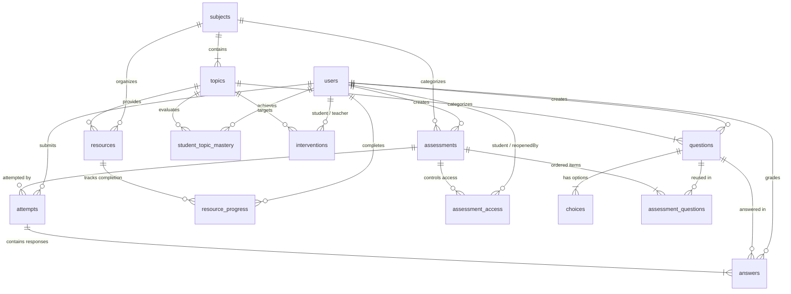

# LearningPal Data Model: Learning & Diagnostic Features

This document details the data architecture supporting LearningPal's learning features: curriculum structure, assessments, scheduling, retake policies, diagnostic topic-level gap analysis, personalized study resources, teacher grade overrides, and academic interventions.

---

## 1. Entity-Relationship (ER) Diagram

---

## 2. Table Dictionary

Think of the LearningPal database like an organized school course binder with dividers, flashcards, quizzes, and gradebooks:

| Table | Plain Analogy / What It Stores |
|---|---|
| `users` | **The School Directory:** The existing roster of all students, teachers, and system administrators. |
| `subjects` | **The Course Binder:** High-level academic courses (e.g. *"Introduction to Programming: C Language Basics"*). |
| `topics` | **The Binder Tab Dividers:** Specific learning units within a subject (e.g. *Variables*, *Loops*, *Functions*); every question and resource belongs to a topic. |
| `questions` | **The Question Bank:** Reusable test questions linked to a topic, with full explanations of correct answers and common mistakes. |
| `choices` | **The Multiple-Choice Options:** The 4 lettered options (A, B, C, D) for each question, flagging exactly one correct answer. |
| `assessments` | **The Test Papers:** Topic quizzes and comprehensive diagnostics assigned to students, including schedule windows (`available_from`, `available_until`, `time_limit_minutes`) and randomization flags (`randomize_questions`, `randomize_choices`). |
| `assessment_questions` | **The Exam Layout Sheet:** Join table connecting questions to assessments with their default order (Question 1, Question 2, etc.), allowing questions to be reused across multiple tests. |
| `assessment_access` | **The Special Permission Hall Pass:** Controls per-student test permissions: enforces the 1-attempt rule by default, allows teachers to reopen closed tests, grant retakes, or extend deadlines for selected students. |
| `attempts` | **The Student's Exam Booklet:** A student's test-taking session on an assessment, recording `attempt_number` (1, 2, etc.), start/submit timestamps, and final scores. |
| `answers` | **The Marked Answers:** Each response given by a student to a question, holding their selected choice/essay, the automated score, an optional teacher override, and teacher feedback. |
| `student_topic_mastery` | **The Diagnostic Report Card:** Summary of how well each student understands each topic (Mastery %, categorized into `STRENGTH`, `DEVELOPING`, or `GAP`). |
| `resources` | **The Study Kit:** Flashcard-style bite-sized study notes and practice challenges designed to help students overcome learning gaps. |
| `resource_progress` | **The Reading Checklist:** Checkmarks recording whether a student has finished reviewing a recommended note or practice problem. |
| `interventions` | **The Teacher Action Plan:** Action items logged by teachers when they notice a student struggling on a topic (e.g., 1-on-1 tutoring, remedial exercises). |

---

## 3. Test Taking, Scheduling, and Reopening Rules

### One-Time Attempt Rule
By default, students can only attempt an assessment **once**.
- When an assessment is started $\rightarrow$ `Attempt` #1 is generated (`attempt_number = 1`, `status = IN_PROGRESS`).
- When submitted $\rightarrow$ `status = SUBMITTED`.
- Any subsequent attempt is blocked unless a teacher explicitly grants permission.

### Set Schedule & Deadlines
- `Assessment.available_from` and `Assessment.available_until`: Defines the calendar window during which students may take the assessment.
- `Assessment.time_limit_minutes`: Optional timer starting when the attempt begins.
- If the current time is outside the schedule window, the assessment is closed to students.

### Teacher Reopening & Retakes (`assessment_access`)
Teachers can override restrictions for specific students (e.g. excused absence, technical issues, or pedagogical second chance):
1. **Reopening a Closed Test:** The teacher sets `assessment_access.extended_until` to a future timestamp, allowing that specific student to submit even if the global test window has passed.
2. **Authorizing a Retake:** The teacher calls `access.grantReopen(teacher, extendedUntil, reason)` which sets `is_reopened = true`.
3. When the student starts the retake, a new `Attempt` record is created with `attempt_number = 2`, preserving the history of Attempt #1 for audit trails and gap progression.

### Question & Choice Randomization
- `Assessment.randomize_questions`: When `true` (default), the test engine shuffles the presentation order of questions so adjacent students see different orderings.
- `Assessment.randomize_choices`: When `true` (default), the test engine shuffles choices A, B, C, D while preserving the pointer to the correct choice entity.

---

## 4. How the Grading Rule Works

In LearningPal, quizzes are graded instantly by the system, but teachers always maintain full pedagogical authority to override any score.

### The Single Source of Truth
Every student response in `answers` stores three score fields:
1. `auto_score`: The score automatically calculated by the system upon submission (e.g., `1.0` if the student selected the correct MCQ choice, or `0.0` if incorrect).
2. `teacher_score`: An optional override score entered manually by a teacher (can award full, partial, or zero credit).
3. `final_score`: The actual grade counted toward the student's mastery.

### The Invariant
$$\text{final\_score} = \begin{cases} \text{teacher\_score} & \text{if present} \\ \text{auto\_score} & \text{otherwise} \end{cases}$$

To prevent subtle bugs caused by updating scores in scattered services, this calculation is encapsulated in a single method inside the [`Answer`](file:///c:/Users/Marion%20Alfeche/LearningPal/backend/src/main/java/com/learningpal/entity/Answer.java) entity:
- When a quiz is auto-graded: `answer.applyAutoScore(1.0);` $\rightarrow$ automatically recalculates `final_score`.
- When a teacher overrides: `answer.applyTeacherOverride(0.5, "Partial credit granted for correct logic", teacherUser);` $\rightarrow$ sets the teacher score, comments, timestamp, and automatically recalculates `final_score`.

---

## 5. How This Data Model Will Be Used in Next Steps

Here is the step-by-step lifecycle enabled by this schema:

1. **Taking an Assessment:**
   - Assessment visibility filter: only `status = PUBLISHED` assessments are visible to students.
   - Schedule validation: verifies `available_from <= now <= available_until` (or student has `extended_until >= now`).
   - Attempt count check: checks student has 0 attempts, or `assessment_access.is_reopened == true`.
   - Randomized delivery: shuffles questions and choices according to assessment flags.
   - On submission $\rightarrow$ `status` changes to `SUBMITTED`, auto-grading populates `auto_score` and `final_score` on each answer, and `totalScore` is updated on `Attempt`.

2. **Automated Topic Gap Analysis:**
   - The gap analysis service groups all answers by their question's `Topic`.
   - For each topic, it calculates:
     $$\text{Mastery \%} = \frac{\sum \text{final\_score}}{\sum \text{max\_points}} \times 100$$
   - It updates `student_topic_mastery`:
     - $\ge 80\% \rightarrow \text{STRENGTH}$ (Green)
     - $60\% - 79\% \rightarrow \text{DEVELOPING}$ (Yellow)
     - $< 60\% \rightarrow \text{GAP}$ (Red)

3. **Personalized Recommendations & Student Feedback:**
   - If a student has a `GAP` in *"Loops"*, LearningPal automatically queries `resources` for that topic and recommends the relevant `NOTE` and `PRACTICE` exercises.
   - When the student reviews them, `resource_progress` marks them completed.

4. **Teacher Review, Override, Re-analysis & Retake:**
   - A teacher reviews student attempts. If an answer was technically sound despite an edge-case, the teacher inputs an override score and comment.
   - Calling `answer.applyTeacherOverride(...)` updates `final_score`.
   - If the student needs to retake the test, the teacher grants a reopen via `AssessmentAccess`.
   - The gap analysis recalculates `student_topic_mastery`, and if the gap persists, the teacher logs an `Intervention` with a follow-up date.
