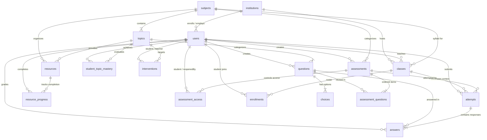

# LearningPal Data Model: Learning, Multi-Institution & Diagnostic Architecture

This document details the data architecture supporting LearningPal: multi-institution tenancy, classroom sections, curriculum structure, assessments, scheduling, retake policies, diagnostic topic-level gap analysis, personalized study resources, teacher grade overrides, and academic interventions.

---

## 1. Entity-Relationship (ER) Diagram



---

## 2. Table Dictionary

Think of the LearningPal database like a multi-school educational network:

| Table | Plain Analogy / What It Stores |
|---|---|
| `institutions` | **The School Campus:** Independent schools, colleges, or districts (e.g., *"Pilot University"*, code `PILOT-2026`). Every user and class belongs to one institution. |
| `classes` | **The Classroom Period / Section:** A specific cohort of students (e.g., *"Section A"*) studying a subject under an assigned instructor, discovered via a 6-character join code. |
| `enrollments` | **The Class Roster:** Connects a student to a specific classroom section (`student_id`, `class_id`). |
| `users` | **The School Directory:** The roster of all students, teachers, institution admins, and platform super-admins. |
| `subjects` | **The Shared Course Binder:** Platform-wide academic subjects (e.g. *"Introduction to Programming: C Language Basics"*), curated centrally and shared read-only. |
| `topics` | **The Binder Tab Dividers:** Specific learning units within a subject (e.g. *Variables*, *Loops*, *Functions*); every question and resource belongs to a topic. |
| `questions` | **The Question Bank:** Reusable test questions linked to a topic, with full explanations of correct answers and common mistakes. |
| `choices` | **The Multiple-Choice Options:** The 4 lettered options (A, B, C, D) for each question, flagging exactly one correct answer. |
| `assessments` | **The Test Papers:** Topic quizzes and comprehensive diagnostics assigned to students, with timing and scheduling windows. |
| `assessment_questions` | **The Exam Layout Sheet:** Join table connecting questions to assessments with their sequence order. |
| `assessment_access` | **The Special Permission Hall Pass:** Controls per-student test permissions: enforces the 1-attempt rule by default, allows teachers to reopen closed tests or grant retakes. |
| `attempts` | **The Student's Exam Booklet:** A student's test session, recording `attempt_number`, timestamps, scores, and the `class_id` context. |
| `answers` | **The Marked Answers:** Each response given by a student to a question, holding auto score, teacher override, and feedback. |
| `student_topic_mastery` | **The Diagnostic Report Card:** Cumulative summary of how well each student understands each topic (`STRENGTH`, `DEVELOPING`, or `GAP`), scoped to the student and subject. |
| `resources` | **The Study Kit:** Flashcard-style bite-sized study notes and practice challenges designed to close learning gaps. |
| `resource_progress` | **The Reading Checklist:** Checkmarks recording whether a student has finished reviewing a recommended note or practice problem. |
| `interventions` | **The Teacher Action Plan:** Action items logged by teachers when they notice a student struggling on a topic. |

---

## 3. Multi-Tenant Isolation Rule

> [!IMPORTANT]
> **Strict Tenant Boundary:** Every student, teacher, and school administrator belongs to exactly one institution.
> 1. No user can view, approve, reject, deactivate, or modify data from another institution.
> 2. Direct ID guessing in URL parameters (e.g., `GET /api/admin/users/99` or `POST /api/admin/teachers/88/approve`) across institutions **always returns HTTP 404 Not Found** (via `TenantAccess`), completely preventing tenant existence discovery.
> 3. Join codes are scoped per institution: entering a code from Institution B while signed into Institution A returns HTTP 404.

---

## 4. Development Database Clean-Rebuild Option

In development environments with MySQL, if you ever need to perform a completely fresh wipe-and-rebuild of the multi-institution schema and seed data:

```bash
# 1. Drop and recreate the local database
mysql -u root -p -e "DROP DATABASE IF EXISTS learningpal; CREATE DATABASE learningpal CHARACTER SET utf8mb4 COLLATE utf8mb4_unicode_ci;"

# 2. Start the backend application (Hibernate ddl-auto=update will recreate all tables)
mvn spring-boot:run -f backend/pom.xml
```

On first startup:
- `DatabaseMigrationRunner` automatically provisions *"Pilot University"* (`PILOT-2026`).
- `AdminUserSeeder` seeds the default institution administrator (`admin@example.com` or `admin@learningpal.edu`).
- `LearningDataSeeder` seeds the full 6-topic C language pilot curriculum and default *"Section A"*.
- `SuperAdminSeeder` seeds the platform super admin (if `app.superadmin.email` is configured).

---

## 5. Test Taking, Scheduling, and Reopening Rules

### One-Time Attempt Rule
By default, students can only attempt an assessment **once**.
- When an assessment is started $\rightarrow$ `Attempt` #1 is generated (`attempt_number = 1`, `status = IN_PROGRESS`, stamped with `class_id`).
- When submitted $\rightarrow$ `status = SUBMITTED`.
- Any subsequent attempt is blocked unless a teacher explicitly grants permission via `AssessmentAccess`.
