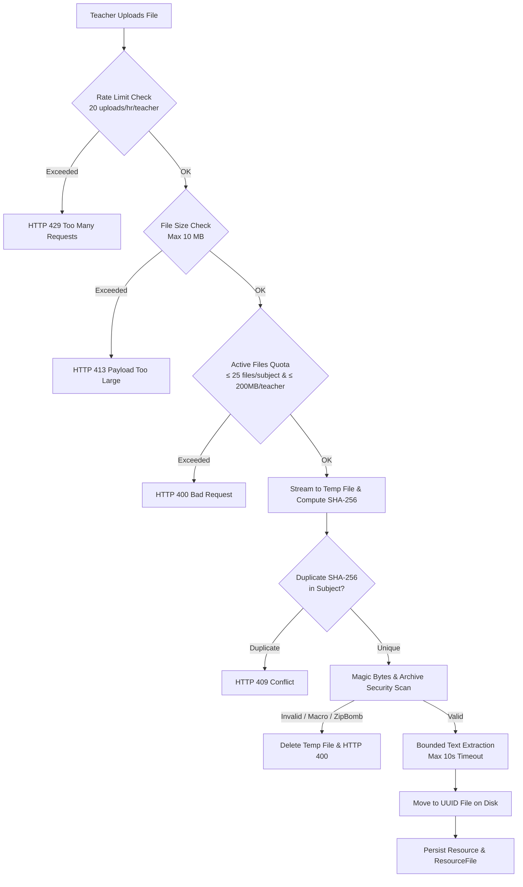

# LearningPal File Resources & Document Extraction Architecture

This document describes the Phase B file resource architecture in LearningPal: how teachers upload course materials (PDF and DOCX), how documents are validated and stored, how text extraction operates safely in a bounded sandbox, and how students securely access study documents.

---

## 1. Supported Document Types

LearningPal strictly restricts file uploads to two standard document formats:

| Format | File Extension | MIME Content-Type | Detection & Inspection |
|---|---|---|---|
| **Portable Document Format** | `.pdf` | `application/pdf` | Magic bytes `%PDF-` header verified via Apache PDFBox 3.0.8 |
| **Modern Word Document** | `.docx` | `application/vnd.openxmlformats-officedocument.wordprocessingml.document` | ZIP header `PK\x03\x04` verified containing OOXML `[Content_Types].xml` and `word/document.xml` via Apache POI 5.5.1 with pre-scan for duplicate zip entry names (CVE-2025-31672 mitigation) |

### Explicitly Prohibited & Blocked Formats
- **Legacy Word (`.doc`)**: Old binary OLE2 Compound File formats (`0xD0CF11E0`) are rejected immediately with a friendly error directing teachers to modern `.docx` format.
- **Macro-Enabled Documents (`.docm`)**: Files with `.docm` extensions or `.docx` archives containing `word/vbaProject.bin` or `word/vbaData.xml` are rejected with HTTP 400 to prevent macro malware execution.
- **Password-Protected / Encrypted Documents**: Encrypted PDFs or password-locked Word archives are rejected with HTTP 400.
- **Executables & Renamed Binaries**: Renamed `.exe`, `.bat`, `.sh`, `.js`, or `.jar` files with deceptive `.pdf` or `.docx` extensions are rejected via magic-byte signature validation.
- **Other Formats**: PPTX, Excel spreadsheets, plain text files, and raw images are not supported as file resources in this phase.

---

## 2. Security Validations, Quotas & Rate Limits



### Quotas & Limits
1. **File Size Limit:** 10 MB per file. Enforced at both the Spring multipart resolver level (`spring.servlet.multipart.max-file-size`) and service level. Returns `HTTP 413 Payload Too Large`.
2. **Subject File Limit:** Maximum 25 active file resources per subject. Returns `HTTP 400 Bad Request`.
3. **Teacher Storage Quota:** Maximum 200 MB total active file storage per teacher across all subjects. Returns `HTTP 400 Bad Request`.
4. **Teacher Upload Rate Limiter:** Maximum 20 file uploads per hour per teacher using an in-memory sliding window limiter (`TeacherUploadRateLimiter`). Resets automatically upon application restart. Returns `HTTP 429 Too Many Requests`.
5. **Duplicate Content Detection:** Computes SHA-256 hash during upload streaming. Uploading the exact same document bytes twice to the same subject is rejected with `HTTP 409 Conflict`.

---

## 3. Storage Directory & Path Safety

- **Storage Location:** Files are stored in `./storage/resources` by default, configurable via `app.files.storage-dir`.
- **Outside Web Root:** The storage directory is strictly located outside web-accessible roots (`static/`, `public/`, and the classpath).
- **UUID Keys:** On disk, files are stored strictly under generated UUID names (e.g. `c9704289-42b4-4b5b-9b43-2287235a9094.pdf`). The original user-supplied file name is never used on the filesystem.
- **Filename Sanitization:** The original file name is sanitized (removing path traversal `../`, control characters, null bytes, and capping at 120 characters) and stored exclusively in `resource_files.file_name` for display and download naming.
- **Directory Traversal Verification:** Every path resolution is checked with `path.normalize().startsWith(storageDirectory)` to prevent directory escape.
- **Atomic File Management:**
  - If document inspection or database persistence fails, temporary files are immediately deleted. No orphaned files remain on disk.
  - Deleting a file resource (`DELETE /api/teacher/files/{id}`) deletes both the database records (`ResourceFile` and `Resource`) and the disk file.
  - **Phase C Deletion Guardrail:** A file referenced by any approved AI question (`questions.source_file_id`) cannot be deleted (`HTTP 409 Conflict`). Archiving remains allowed to hide the file from students while preserving question lineage and provenance. A file with only pending or rejected drafts deletes cleanly along with its drafts and job records.

---

## 4. Hardened Text Extraction Sandbox

Extracted document text serves as the foundation for LearningPal's future AI quiz drafting tools. Because documents uploaded by users could be malformed or adversarial, extraction is heavily fortified:

1. **Dedicated Worker Pool:** Text extraction runs inside a bounded thread pool (`doc-extractor-pool`, 2 threads).
2. **Timeout Boundary:** Extraction tasks are governed by a strict 10-second timeout (`Future.get(10, TimeUnit.SECONDS)`). If processing exceeds 10 seconds, the task is cancelled to avoid CPU/memory starvation.
3. **PDF Page Cap:** PDFs with more than 300 pages are rejected during inspection.
4. **Zip-Bomb Protection for DOCX:**
   - Maximum entry count: 1,000 ZIP entries.
   - Maximum uncompressed size: 50 MB total decompression ceiling.
5. **Character Cap:** Extracted text is normalized (condensing whitespace and unifying CRLF to LF) and capped at 500,000 characters.
6. **Extraction Statuses:**
   - `READY`: Text extracted successfully.
   - `EMPTY`: No readable text streams found (e.g., scanned paper or image-only PDF). The status displays a clear note to the teacher explaining that scanned documents require machine-readable text for AI generation.
   - `FAILED`: Document parsing failed or timed out. An error note is recorded.
7. **Zero Leakage to Students:**
   - `extracted_text` is stored in the backend and is ONLY accessible to the owning teacher via the preview endpoint (`GET /api/teacher/files/{id}/text-preview`).
   - Student study material endpoints (`GET /api/student/classes/{classId}/materials`) and topic recommendations DTOs never include the extracted text field.

---

## 5. Secure File Streaming & Access Matrix

### Download Access Control
- **Teacher Owner:** Can download their own files via `GET /api/teacher/files/{id}/download`.
- **Enrolled Student:** Can download active class files via `GET /api/student/classes/{classId}/files/{fileId}/download`.
  - Accessible ONLY if the student is actively enrolled in an `ACTIVE` class. Students in an `ARCHIVED` class receive `HTTP 404 Not Found`.
  - The target file must belong to that class's subject and must be in `ACTIVE` status.
- **Zero Information Leakage:** Unenrolled students, students in archived classes, students from other institutions, other teachers in the same or foreign institutions, or school administrators attempting to access a file return `HTTP 404 Not Found` (never HTTP 200).
- **Archived Files:** When a teacher archives a file resource, it is immediately hidden from student materials and student download attempts return `HTTP 404 Not Found`.

### Hardened HTTP Download Headers
All file downloads streamed by the backend set defensive security headers:
```http
Content-Disposition: attachment; filename="document.pdf"; filename*=UTF-8''document.pdf
Content-Type: application/pdf
X-Content-Type-Options: nosniff
Cache-Control: no-store, no-cache, must-revalidate, max-age=0
Pragma: no-cache
```

---

## 6. Honest System Boundaries

To ensure clear operational expectations:
1. **No Optical Character Recognition (OCR):** Scanned documents consisting solely of bitmap images without an embedded text layer will produce an `EMPTY` extraction status. Teachers must supply text-based PDF or DOCX files for AI drafting.
2. **No Antivirus Daemon (ClamAV):** LearningPal does not run an integrated antivirus daemon. Safety is maintained through strict file format whitelisting, ZIP bomb thresholds, VBA macro bans, path sanitization, and execution isolation.
3. **No In-Browser Document Rendering:** Students and teachers download documents to their local devices; LearningPal does not embed third-party PDF or Office web viewers.
