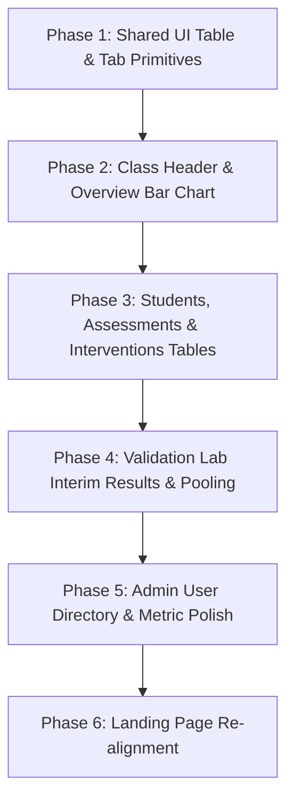

# UX Audit & Design Proposal: Teacher & Admin Portals

**Document**: `docs/UX_PROPOSAL_TEACHER_ADMIN.md`  
**Status**: DRAFT PROPOSAL (Read-Only Audit)  
**Target Areas**: Teacher Class Workspace (`/teacher/classes/:id`), Teacher Validation Lab (`/teacher/classes/:id/validation`), Admin Portal (`/admin`, `/admin/evaluation`, `/admin/validation`)  
**Design System**: LearningPal Composition Notebook Tokens (`DESIGN.md`, `PRODUCT.md`, Tailwind CSS)

---

## 1. Inventory & Friction Analysis

A comprehensive audit of the Teacher and Admin views reveals significant UI density and vertical scroll fatigue. On first load, pages render dozens of full-sized cards without progressive disclosure, search, or pagination.

### Screen Inventory & First-Load Card Count

| Screen & Route | Major Sections | Visible Cards / Items on Load (30-student cohort, 8 quizzes) | First-Load Friction Rank | Primary UX Defect |
|---|---|:---:|:---:|---|
| **Teacher Class Detail**<br>`/teacher/classes/:id` | • Join Code Card<br>• Class Settings Card<br>• Learning Gap Overview (topic cards)<br>• Assessment Controls (quiz cards)<br>• Student Roster (student cards)<br>• Interventions Tracker (intervention cards)<br>• Feedback Ratings & Anonymous Comments | **68+ cards**<br>*(scales to 150+ cards with 100 students)* | **#1 Worst** | Monolithic vertical scroll; no tab separation; DOM overload; cards used where tabular data is needed. |
| **Teacher Subject Workspace**<br>`/teacher/subjects/:id` | • Subject Header & Sample Clone<br>• Topics List<br>• Question Bank & Editor<br>• Quiz Assembler & Schedule<br>• Document Files & Local AI Drafting<br>• External Study Links | **45+ cards** | **#2 Worst** | 200KB single-component page (`TeacherSubjectDetail.jsx`); long stacked lists; modal proliferation. |
| **Teacher Validation Hub**<br>`/teacher/classes/:id/validation` | • Educational Explainer<br>• 30-Student Target Progress Bar<br>• Student Evaluation Candidate Cards | **32+ cards** | **#3 Worst** | Progress bar implies a single teacher must label 30 students alone; no interim feedback; unclear why mastery is hidden. |
| **Teacher Student Detail**<br>`/teacher/classes/:id/students/:id` | • Student Header & Diagnostic Stamp<br>• Topic Mastery Breakdown Cards<br>• Quiz Attempt Cards & Answer Reviews<br>• Grade Override Controls<br>• Intervention Timeline | **18–25 cards** | **#4** | Long attempt question lists; lacks quick navigation between students in the same class. |
| **Teacher Dashboard**<br>`/teacher` | • Welcome Greeting<br>• Active Class Sections Grid<br>• Quick Actions & Portal Links | **4–12 cards** | **#5** | Clean layout, but class grid lacks search and archiving filters when teachers manage > 8 classes. |
| **Admin Home**<br>`/admin` | • Pending Teacher Approvals List<br>• Institution User Directory Table<br>• Quick Evaluation Navigation | **15–40 rows/cards** | **#6** | Pending approvals use bulky cards; directory lacks text search and pagination. |
| **Admin Evaluation Dashboard**<br>`/admin/evaluation` | • Target Status Cards (Kappa, Ratings, Survey)<br>• Ratings Summary & Metric Breakdown<br>• Usability Survey Scorecard<br>• Validation Agreement Summary | **12 cards** | **#7** | Informative, but visually uniform; statistical terms lack quick tooltip explainers. |
| **Admin Validation Report**<br>`/admin/validation` | • Target Check Banner<br>• Confusion Matrix Card<br>• Cohen's Kappa & Agreement Stats<br>• Per-Topic Sensitivity Table<br>• Disagreements Detail List | **8 cards** | **#8** | High academic value; needs plain-language executive summary for non-technical deans. |

---

## 2. Landing Page Demo vs. Real Product Gap Analysis

The interactive demo in `frontend/src/components/InteractiveDemo.jsx` established an intuitive, high-craft benchmark. However, the real teacher view diverged into an unbundled single-page scroll.

```
┌────────────────────────────────────────────────────────────────────────┐
│ LANDING PAGE DEMO (Tabbed, Visual, Compact)                             │
├────────────────────────────────────────────────────────────────────────┤
│ [Header: 4 Key Metrics] ─── [Topic Mastery Bar Chart (Recharts)]       │
│ [Student Roster Quick-Select] ─── [Intervention Log & Progress]        │
└────────────────────────────────────────────────────────────────────────┘
                                    VS
┌────────────────────────────────────────────────────────────────────────┐
│ REAL PRODUCT (Monolithic, Card-Heavy, Unpaginated)                      │
├────────────────────────────────────────────────────────────────────────┤
│ [Join Code Card] ─── [Settings Card]                                   │
│ [Topic Card 1] [Topic Card 2] ... [Topic Card 8]                       │
│ [Quiz Card 1] [Quiz Card 2] ... [Quiz Card 10]                         │
│ [Student Card 1] [Student Card 2] ... [Student Card 32]                │
│ [Intervention Card 1] [Intervention Card 2] ... [Intervention Card 15] │
│ [Feedback Card 1] [Feedback Card 2] [Comment Card 1] ...               │
└────────────────────────────────────────────────────────────────────────┘
```

### Detailed Gap Comparison

| Feature / UI Element | Landing Page Interactive Demo | Real Product Implementation | Gap Status | Resolution in Proposal |
|---|---|---|:---:|---|
| **Class Gap Overview** | Clean, visual **Bar Chart** (`recharts` `BarChart`) with 70% threshold line, color-coded bars, and topic summary pills below. | 8+ separate stacked `NotebookCard`s with mini horizontal progress bars and raw text statistics. | **DIFFERS**<br>*(Key User Complaint)* | **Match the demo**: Implement the Recharts Bar Chart in the new Overview tab with benchmark lines. |
| **Page Architecture** | Compact, tabbed notebook view (`Tab 2: Teacher Gradebook`) fitting critical data in viewport. | Monolithic continuous vertical scroll containing 6 heavy sections in a single DOM tree. | **DIFFERS** | Introduce 5 tabs: **Overview**, **Students**, **Assessments**, **Interventions**, **Ratings**. |
| **Header Metrics** | 4 compact KPI cards: Average Mastery (74%), Students with Gaps (6), Weakest Topic (Meiosis II), Active Interventions (3). | 2 massive configuration cards: Join Code (with QR code) and Class Settings taking up 400px of vertical space. | **DIFFERS** | Condense class info/settings into a slim header bar; promote the 4 instructional KPIs to the Overview tab. |
| **Student Roster** | Interactive table with quick selection, displaying Name, Diagnostic %, Topics Mastered / Gap count, Intervention status. | Full-width cards per student with nested progress bars, attempt counts, and action buttons. | **DIFFERS** | Replace cards with a searchable, sortable, paginated data table. Rows link to `TeacherStudentDetail`. |
| **Interventions** | Clean log showing date, student, topic, and status pill alongside a quick entry form. | Multiple stacked intervention cards with inline status update dropdowns and lengthy notes. | **DIFFERS** | Move to dedicated **Interventions Tab** with a filterable, paginated table and modal/drawer logger. |
| **Assessment Controls** | Omitted from demo for simplicity. | Card per quiz with inline schedule pickers, retake unlocks, and date pickers. | **REAL-ONLY** | Move to dedicated **Assessments Tab** as a clean data table with status badges and modal actions. |
| **Validation Lab** | Omitted from demo. | Separate hub and labeling screen accessed via header buttons. | **REAL-ONLY** | Keep separate; polish explanation and distribute institution targets. |

---

## 3. Proposed Layout Wireframes

### Wireframe 1: Slim Class Header & Tab Navigation
Condenses configuration cards into an accessible, compact header bar. The join code is visible to the teacher only with 1-click copy and popover settings.

```text
+----------------------------------------------------------------------------------------------------+
| [< Back to Classes]                                           [Export Report] [Validation Lab ->]  |
|                                                                                                    |
| Bio 101 - Period 3                                      Join Code: [ C658C5 ] (Copy) (QR)          |
| Subject: Biology Basics • Active (32 Students)          Enrollment: [ OPEN v ]  [Settings / Archive]|
+----------------------------------------------------------------------------------------------------+
|  [ [Overview] ]    [ Students (32) ]    [ Assessments (8) ]    [ Interventions (5) ]   [ Ratings ] |
+----------------------------------------------------------------------------------------------------+
```

---

### Wireframe 2: Tab 1 — Overview (Matching Landing Page Demo)
Surfaces the 4 headline metric cards and the per-topic Recharts bar chart.

```text
+----------------------------------------------------------------------------------------------------+
|  KEY METRICS                                                                                       |
|  +--------------------+ +--------------------+ +--------------------+ +--------------------------+ |
|  | Average Mastery    | | Needs Attention    | | Weakest Topic      | | Active Interventions     | |
|  |     74.2%          | |   6 Students       | |   Cell Division    | |   3 Active (2 Pending)   | |
|  |  (Developing)      | |  (>= 2 Gap Topics) | |      52.0% (GAP)   | |  [View Interventions ->] | |
|  +--------------------+ +--------------------+ +--------------------+ +--------------------------+ |
|                                                                                                    |
|  CLASS TOPIC GAP OVERVIEW (Matching Interactive Demo)                        Benchmark: -- 70%     |
|  100% |                                                                                            |
|   80% |   [85%]                                                                                    |
|       |   +---+               [78%]                           [82%]                                |
|   60% |   |   |               +---+           [64%]           +---+                                |
|   40% |   |   |   [48%]       |   |           +---+   [52%]   |   |                                |
|   20% |   |   |   +---+       |   |   [38%]   |   |   +---+   |   |                                |
|    0% +---+---+---+---+-------+---+---+---+---+---+---+---+---+---+------------------------------+ |
|         Cell Bio   Genetics    Organs  Ecology Physio  Divis. Evolut.                              |
|         (Mastery)   (GAP)     (Devel)  (GAP)   (Devel) (GAP)  (Mastery)                            |
|                                                                                                    |
|  +---------------------------------------------+ +-----------------------------------------------+ |
|  | TOP 3 TOPICS NEEDING ATTENTION              | | PENDING TEACHER ACTIONS                       | |
|  | 1. Ecology & Biomes (38.0% avg - 14 gaps)   | | • 2 quiz attempts awaiting manual review      | |
|  | 2. Genetics & Punnett (48.0% avg - 11 gaps) | | • 1 student requested diagnostic retake unlock| |
|  | 3. Cell Division (52.0% avg - 9 gaps)       | | • 3 completed interventions need outcome notes| |
|  +---------------------------------------------+ +-----------------------------------------------+ |
+----------------------------------------------------------------------------------------------------+
```

---

### Wireframe 3: Tab 2 — Students (Searchable, Sortable, Paginated Table)
Replaces 32+ individual student cards with a high-density, accessible table.

```text
+----------------------------------------------------------------------------------------------------+
|  STUDENT ROSTER                                                                                    |
|  [ Search students by name or email...   ]  Filter: [ All Students v ]  Sort: [ Lowest Mastery v ] |
|                                                                                                    |
|  +-----------------------------------------------------------------------------------------------+ |
|  | Student Name           | Overall Mastery | Gap Topics ( < 60% ) | Interventions | Actions     | |
|  +-----------------------------------------------------------------------------------------------+ |
|  | [Avatar] Maya Lin      |  54.5% (GAP)    | 3 Topics (Bio, Eco)  | 1 Active      | [View Detail| |
|  | [Avatar] Jordan Lee    |  58.0% (GAP)    | 2 Topics (Genetics)  | None          | [View Detail| |
|  | [Avatar] Alex Rivera   |  68.0% (DEV)    | 1 Topic (Ecology)    | 1 Done        | [View Detail| |
|  | [Avatar] Casey Past    |  84.0% (STR)    | 0 Topics             | None          | [View Detail| |
|  | [Avatar] Sam Taylor    |  91.5% (STR)    | 0 Topics             | None          | [View Detail| |
|  +-----------------------------------------------------------------------------------------------+ |
|  Showing 1 - 10 of 32 students                       [< Prev]  Page [ 1 ] of 4  [Next >]          |
+----------------------------------------------------------------------------------------------------+
```

- **Table Columns**:
  1. `Student Name & Email` (with avatar & status badge)
  2. `Diagnostic / Overall Mastery` (percentage + colored badge)
  3. `Topic Breakdown Summary` (count of STRENGTH / DEVELOPING / GAP)
  4. `Active Interventions` (badge: None / 1 Active / Pending Note)
  5. `Actions` (Primary: `View Detail ->`, opens `/teacher/classes/:id/students/:studentId`)

---

### Wireframe 4: Tab 3 — Assessments (Status Filtered, Schedule Controls)
Replaces 8+ large quiz cards with a streamlined operational table.

```text
+----------------------------------------------------------------------------------------------------+
|  CLASS ASSESSMENTS                                                                                 |
|  Filter: [ All (8) v ]  [ Published (6) ]  [ Scheduled (1) ]  [ Closed (1) ]                       |
|                                                                                                    |
|  +-----------------------------------------------------------------------------------------------+ |
|  | Assessment Title       | Status       | Window / Deadlines       | Completed | Actions        | |
|  +-----------------------------------------------------------------------------------------------+ |
|  | Diagnostic Assessment  | PUBLISHED    | Open (No deadline)       | 31 / 32   | [Settings]     | |
|  | Quiz 1: Cell Organelles| PUBLISHED    | Due Nov 15, 11:59 PM     | 28 / 32   | [Unlock Retake]| |
|  | Quiz 2: Meiosis Basics | SCHEDULED    | Opens Nov 18, 8:00 AM    |  0 / 32   | [Edit Schedule]| |
|  | Midterm Assessment     | CLOSED       | Ended Nov 01             | 32 / 32   | [View Results] | |
|  +-----------------------------------------------------------------------------------------------+ |
|  Showing 1 - 4 of 8 assessments                      [< Prev]  Page [ 1 ] of 2  [Next >]          |
+----------------------------------------------------------------------------------------------------+
```

---

### Wireframe 5: Tab 4 — Interventions (Filterable Table & Quick Log)
Transforms unstructured cards into an accountability tracker.

```text
+----------------------------------------------------------------------------------------------------+
|  PEDAGOGICAL INTERVENTIONS                                         [ + Log 1-on-1 Intervention ]   |
|  Filter: [ All Statuses v ]  [ Type: All v ]  Search: [ Student name...                          ] |
|                                                                                                    |
|  +-----------------------------------------------------------------------------------------------+ |
|  | Student       | Target Topic   | Type         | Planned For | Status     | Outcome / Mastery  | |
|  +-----------------------------------------------------------------------------------------------+ |
|  | Maya Lin      | Ecology Biomes | Office Hours | Nov 12, 2pm | PLANNED    | Pending session    | |
|  | Jordan Lee    | Genetics       | Peer Tutor   | Nov 10      | DONE       | 45% -> 72% (+27%)  | |
|  | Alex Rivera   | Cell Division  | Mini-Lesson  | Nov 08      | DONE       | 50% -> 68% (+18%)  | |
|  +-----------------------------------------------------------------------------------------------+ |
|  Showing 1 - 3 of 14 interventions                   [< Prev]  Page [ 1 ] of 5  [Next >]          |
+----------------------------------------------------------------------------------------------------+
```

---

### Wireframe 6: Tab 5 — Ratings & Feedback
Dedicated view for student feedback and rating metrics without crowding instructional tools.

```text
+----------------------------------------------------------------------------------------------------+
|  STUDENT RATINGS & ANONYMOUS FEEDBACK                                                              |
|  +----------------------------------+ +----------------------------------+                         |
|  | Resource Helpfulness Rating      | | Feedback Response Rate           |                         |
|  | 4.6 / 5.0 (28 ratings logged)    | | 87.5% (28 of 32 students)        |                         |
|  +----------------------------------+ +----------------------------------+                         |
|                                                                                                    |
|  RECENT ANONYMOUS COMMENTS                                                                         |
|  • "The video on meiosis chromosome separation was super clear, helped me get the quiz right."     |
|  • "Need more practice questions on punnett squares with heterozygous parents."                    |
+----------------------------------------------------------------------------------------------------+
```

---

### Edge States: Empty, Loading, Error, and High-Volume Cohorts

````carousel
```text
LOADING STATE
+----------------------------------------------------------------------------------------------------+
| Bio 101 - Period 3                                      [ Skeleton Badge ]                         |
| [====================================== Skeleton Tab Strip ======================================] |
|                                                                                                    |
|        ( * ) Computing class topic mastery and student progress across curriculum...               |
|                                                                                                    |
+----------------------------------------------------------------------------------------------------+
```
<!-- slide -->
```text
EMPTY ROSTER STATE (New Class Section)
+----------------------------------------------------------------------------------------------------+
| Bio 101 - Period 3                                      Join Code: [ RHML6X ] (Copy)               |
| [ Overview ]  [ Students (0) ]  [ Assessments (0) ]  [ Interventions (0) ]  [ Ratings ]            |
|                                                                                                    |
|                             [ Users Icon: No Students Enrolled Yet ]                               |
|           Share join code RHML6X with your students so they can join this section.                 |
|                   [ Copy Student Invite Link ]    [ Open Class Settings ]                          |
+----------------------------------------------------------------------------------------------------+
```
<!-- slide -->
```text
LARGE-DATA COHORT (200 Students, 50 Quizzes)
+----------------------------------------------------------------------------------------------------+
|  STUDENT ROSTER                                                                                    |
|  [ Search Maya... ]  Filter: [ Needs Attention (42) v ]  Sort: [ Lowest Mastery v ]  Page Size [25v]|
|  +-----------------------------------------------------------------------------------------------+ |
|  | Student Name (Showing 25 of 200)       | Overall Mastery | Gap Topics | Status   | Actions    | |
|  +-----------------------------------------------------------------------------------------------+ |
|  | Maya Lin                               |  48.0% (GAP)    | 4 Topics   | 1 Active | [Detail]   | |
|  | ... (24 rows rendered via virtualized or paginated DOM; zero scroll lag) ...                  | |
|  +-----------------------------------------------------------------------------------------------+ |
|  Showing 1 - 25 of 200 students                    [< Prev] [1] 2 3 4 5 6 7 8 [Next >]             |
+----------------------------------------------------------------------------------------------------+
```
<!-- slide -->
```text
ERROR / NETWORK RETRY STATE
+----------------------------------------------------------------------------------------------------+
| Bio 101 - Period 3                                                                                 |
|                                                                                                    |
|   /!\ Unable to load class roster: Connection timed out.                                           |
|       Your session is safe and student records are preserved.                                      |
|                                                                                                    |
|       [ Try Again ]          [ Back to Classes ]                                                   |
+----------------------------------------------------------------------------------------------------+
```
````

---

## 4. Backend Needs & API Architecture

### Endpoint Capability Matrix

| Existing Endpoint | Purpose | Current Backend Capabilities | Proposed Backend Needs for Tables |
|---|---|---|---|
| `GET /api/teacher/classes/{id}/overview` | Class mastery & topic distributions | Returns full topic mastery list + headline averages. | **Sufficient as-is**. Powers the Overview Bar Chart directly. |
| `GET /api/teacher/classes/{id}/roster` | Student roster & diagnostic score | Returns unpaginated `List<ClassRosterStudentDto>`. | **Add Optional Query Params**:<br>`?search=` (name/email)<br>`?gapFilter=ALL\|NEEDS_ATTENTION`<br>`?page=0&size=20`<br>`?sortBy=name\|mastery&dir=asc\|desc` |
| `GET /api/teacher/classes/{id}/assessments` | Class quiz controls & settings | Returns unpaginated `List<TeacherClassAssessmentDto>`. | **Client-side filtering sufficient** for <= 50 quizzes; optional `?status=PUBLISHED` query param. |
| `GET /api/teacher/classes/{classId}/interventions` | Logged teacher interventions | Returns unpaginated `List<TeacherInterventionDto>`. | **Add Optional Query Params**:<br>`?status=PLANNED\|DONE\|CANCELLED`<br>`?page=0&size=20` |
| `GET /api/teacher/classes/{id}/ratings-summary` | Feedback ratings & comments | Returns summary record with comments list. | **Sufficient as-is**. |

> [!IMPORTANT]
> **Backward Compatibility & Ponytail Principle**:
> For cohorts up to 100 students, all sorting, searching, and pagination can be performed **instantaneously on the client** using the existing endpoint payloads.
> Backend pagination query parameters should be added as *optional* enhancements (`@RequestParam(required = false)`), ensuring zero breaking changes to existing endpoints.
> Any modified endpoints must retain existing tenant isolation rules (returning generic 404 for foreign classes) and be validated in `docs/ISOLATION_MATRIX.md` and `IsolationMatrixTests`.

---

## 5. Validation Lab & Admin Validation Deep Dive

### Current Friction Points in the Validation Lab
1. **The "Solo 30-Student" Misconception**:
   The header prominently displays a progress bar: `0 / 30 Students Labeled`. Individual teachers assume they are personally required to label 30 students, causing evaluation abandonment.
2. **Missing Pedagogical Rationale**:
   Teachers are confused why the student's mastery score, current quiz percentage, and gap status are hidden on the labeling screen. Some teachers file bug reports believing data failed to load.
3. **All-or-Nothing Results**:
   Agreement reports display `"NOT_ENOUGH_RECORDS"` until the sample threshold is reached. Teachers receive zero positive reinforcement while labeling.

```
┌────────────────────────────────────────────────────────────────────────┐
│ VALIDATION LAB: CURRENT VS. PROPOSED FLOW                              │
├────────────────────────────────────────────────────────────────────────┤
│ CURRENT:                                                               │
│ [0/30 Labeled Bar] ──> [Student Card List] ──> [Blind Form (No "Why")] │
│                           └──> [Report: "NOT ENOUGH RECORDS" (Locked)] │
│                                                                        │
│ PROPOSED:                                                              │
│ [Institution Pool: 18/30] ──> [Filter: Unlabeled / Saved]              │
│       │                              │                                 │
│       ▼                              ▼                                 │
│ [Why Blind? Callout]        [Preliminary Report (n=18, Watermarked)]   │
└────────────────────────────────────────────────────────────────────────┘
```

### Proposed Validation Lab Enhancements

#### 1. Plain-Language "Why Blind?" Callout
Add a prominent notebook callout card on `TeacherValidationLabeling.jsx`:
> **Why are student grades hidden on this page?**  
> *"To scientifically validate LearningPal's automated gap classifier, your professional evaluation must remain unbiased. If you saw the algorithm's scores before judging, it would compromise the study's empirical validity. You are evaluating raw student work alone."*

#### 2. Distributed Institution Target ("Pool Across Teachers")
Update `TeacherValidationHub.jsx` and the backend `ValidationService` to distinguish between **Institution Total** and **Individual Contribution**:
- **Banner**: `Institution Progress: 21 / 30 Target Students Labeled (70%)`
- **Sub-badge**: `Your contribution: 8 students labeled in this class`
- **Callout**: *"Labels from all teachers across your institution contribute toward the required 30-student sample."*

#### 3. Preliminary Interim Agreement ("Preliminary, n of 30")
Update `ValidationReportView.jsx` to display interim agreement metrics even when $n < 30$, watermarking the banner:
- When $n < 30$: Badge displays `PRELIMINARY (n = 14 / 30 required)`.
- Explainer: *"Preliminary agreement trends are shown for feedback. Official benchmark certification requires at least 30 labeled student-topic pairs."*
- When $n \ge 30$: Badge updates to `OFFICIAL BENCHMARK VALIDATED`.

#### 4. Save & Resume Status Indicators
In the student candidate list, add status badges:
- `UNLABELED` (Gray)
- `IN PROGRESS (2/5 Topics)` (Amber, with Resume button)
- `COMPLETED` (Mint Green, with Edit button)

---

## 6. Admin Portal Audit & Design Proposal

### Current Admin Screens
1. **Admin Home (`AdminHome.jsx`)**:
   - Manages pending teacher registrations (`/api/admin/teachers/pending`).
   - Displays institution users directory (`/api/admin/users`).
   - Quick navigation to evaluations.
2. **Admin Evaluation Dashboard (`AdminEvaluationDashboard.jsx`)**:
   - High-level metric dashboard tracking Cohen's Kappa target ($\ge 0.60$), rating target ($\ge 80\%$), and survey target ($\ge 4.0$).
3. **Admin Validation Agreement Report (`AdminValidationReport.jsx`)**:
   - Institutional rollup of blind validation agreement across all teachers.

### Proposed Admin Improvements (Lightweight & Consistent)
- **Pending Approvals Queue**: Replace bulky individual cards with a compact triage table featuring quick inline `[Approve]` and `[Reject]` actions.
- **User Directory Table**:
  - Add instant text search by teacher/student name or email.
  - Add role toggle pills (`All`, `Teachers`, `Students`).
  - Add pagination controls (default 20 rows per page).
- **Plain-Language Statistical Tooltips**:
  - Add `(?)` tooltip next to Cohen's Kappa explaining: *"Cohen's Kappa measures agreement beyond chance. A score above 0.60 indicates strong agreement between teachers and our automated classifier."*
  - Add plain-language labels to Confusion Matrix cells (`True Positive: Both agreed student has a gap`).

---

## 7. Phased Implementation Plan

To keep changes low-risk, maintainable, and testable, the overhaul is split into 6 focused phases.



### Phase 1: Shared UI Table & Navigation Primitives
- **Objective**: Build reusable, accessible table, tab, and search primitives adhering to the notebook aesthetic.
- **Files Touched**:
  - `frontend/src/components/NotebookPrimitives.jsx` (add `NotebookTable`, `NotebookTabs`, `PaginationControls`, `SearchInput`).
- **Tests**: Verify keyboard focus, ARIA role attributes (`role="tablist"`, `role="tab"`), and mobile responsiveness.

### Phase 2: Class Page Header & Overview Bar Chart
- **Objective**: Replace the monolithic scroll header and topic cards with the slim header and Recharts topic bar chart.
- **Files Touched**:
  - `frontend/src/pages/TeacherClassDetail.jsx` (split into tab container; implement Recharts bar chart in Tab 1).
- **Verification**: Visual parity with `InteractiveDemo.jsx` bar chart; 100% theme compatibility (light ruled paper & dark chalkboard).

### Phase 3: Students, Assessments & Interventions Tables
- **Objective**: Convert raw card grids into searchable, sortable, paginated tables.
- **Files Touched**:
  - `frontend/src/pages/TeacherClassDetail.jsx` (render Tab 2: Students, Tab 3: Assessments, Tab 4: Interventions, Tab 5: Ratings).
- **Verification**: Instant filtering of 30–200 students; modal triggers (schedule, unlock retake, log intervention) execute cleanly.

### Phase 4: Validation Lab Overhaul
- **Objective**: Introduce institutional pooling, "Why Blind?" callouts, and preliminary interim report watermarks.
- **Files Touched**:
  - `frontend/src/pages/TeacherValidationHub.jsx`
  - `frontend/src/pages/TeacherValidationLabeling.jsx`
  - `frontend/src/components/ValidationReportView.jsx`
  - `backend/src/main/java/com/learningpal/service/ValidationService.java` (support interim reporting and contributor counts).
- **Tests**: Add backend tests in `ValidationLabTests.java` verifying report generation when $n < 30$.

### Phase 5: Admin Pages Refinement
- **Objective**: Polish user directory search, add pagination, and provide statistical tooltips.
- **Files Touched**:
  - `frontend/src/pages/AdminHome.jsx`
  - `frontend/src/pages/AdminEvaluationDashboard.jsx`

### Phase 6: Landing Page Demo Sync & Regression Testing
- **Objective**: Rebuild any outdated demo components directly from the real production primitives.
- **Files Touched**:
  - `frontend/src/components/InteractiveDemo.jsx`
- **Verification**: Run `mvn test` (182+ tests pass) and `npm run build`.

---

## 8. Open Questions for Approval

1. **Overview Bar Chart Benchmark Line**:  
   The landing demo displays a fixed red benchmark reference line at **70%**. Should this line remain at 70% (Developing threshold), or should it align with the **80%** STRENGTH target?
2. **Client-Side vs. Server-Side Pagination**:  
   For cohorts up to 100 students, client-side pagination on the existing API payloads is instantaneous (0ms network round-trip). Should we implement client-side pagination first and introduce server-side pagination query parameters in a later backend optimization pass?
3. **Interventions Creation Workflow**:  
   Would teachers prefer logging an intervention via a slide-over notebook side-panel (drawer) directly on the class page, or should it remain a modal dialog?
4. **Validation Lab Teacher Attribution**:  
   Should teachers be able to see the names of other teachers who contributed to the institution's 30-student validation goal, or should collaborator names remain anonymous?
5. **Archived Quizzes & Inactive Students**:  
   Should archived quizzes and inactive students be hidden by default behind an "Include Archived" filter toggle in their respective tables?

---

*Proposal compiled by Antigravity Design & Frontend Agent.*  
*Ready for user review.*
